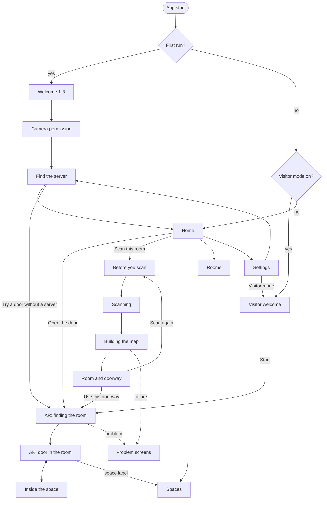

# Interface specification

For the chat that builds `app/`. It describes the screens, their states and texts, and an order of work in
which every step leaves a usable app. Written on 21 November 2026 against the code and the server contract
of that day. "Vrata" is a working name.

- Clickable mockups of every screen: [mockups/index.html](mockups/index.html). Where this document and the
  mockups differ, this document wins.
- Why these features: [product-concept.md](product-concept.md). What others do: [competitors.md](competitors.md).

Nothing here has been built or tried on a phone. Points that need a device check are marked **Check**.

## 1. Principles

1. **One amber button per screen.** It is the next sensible step. Everything else is quieter.
2. **Over the camera, almost nothing.** At most a close button, one label, one menu and one main control.
3. **One instruction at a time**, in words a visitor understands. No codes, coordinates or internal names.
4. **Every problem says what happened and offers one way forward.**
5. **The app does the technical steps itself.** The user never chooses a provider, starts a recording by
   hand or presses "upload".
6. **Everything technical lives in developer options**, off by default.
7. **Say only what is true.** Counters show what the phone actually knows. Times come from measurements.

## 2. Words

| Say | Meaning | Never show |
|---|---|---|
| door | the virtual door | portal, anchor |
| doorway | the real opening in the wall | opening, portal pose |
| room | a scanned place | map, map id |
| space | the virtual place behind the door | world, environment, scene |
| scan | walking the room with the camera | recording, capture, session |
| server | the PC that remembers rooms (host screens only; visitors never see the word) | provider, API, address unless asked |
| finding your room | working out where the phone is | localisation, relocalise, tracking, pose, VPS |

Sentence case everywhere. Buttons are verbs: "Open the door", "Scan this room", "Send again".

## 3. Visual language

### 3.1 Colour

Two meanings carry the whole interface:

- **Teal is the real room as the app understands it**: scan paint, the room plan, wall warnings.
- **Amber is the door and the main action**: the primary button, the doorway on the plan, rings to move to.

| Token | Light | Dark | Use |
|---|---|---|---|
| `bg` | `#F4F6F9` | `#0C111A` | screen background |
| `surface` | `#FFFFFF` | `#151C28` | cards, sheets |
| `surface2` | `#E9EDF2` | `#1E2736` | icon tiles, notices, tracks |
| `ink` | `#131A26` | `#EEF2F8` | text |
| `ink2` | `#566074` | `#9AA6BA` | secondary text |
| `line` | `#D7DCE5` | `#2A3445` | borders, dividers |
| `amber` | `#FFB23E` | `#FFB84D` | primary button fill, doorway |
| `amberInk` | `#2A1A00` | `#2A1A00` | text on amber |
| `amberText` | `#8F5400` | `#FFC873` | amber used as text or icon |
| `amberSoft` | `#FFF0D6` | `#3A2A10` | selected option, amber tile |
| `teal` | `#0B8580` | `#3FD0C6` | plan lines, "ready", switches |
| `tealSoft` | `#D8F0EE` | `#12363A` | plan fill, teal tile |
| `danger` | `#C2352B` | `#FF7A6E` | problems |
| `dangerSoft` | `#FBE4E1` | `#3B1A18` | problem tile |
| `ok` | `#1B7F45` | `#5AD08A` | connected dot |

Screens over the camera have one look in both themes, because they sit on live video:

| Token | Value | Use |
|---|---|---|
| `hudBg` | `rgba(9,13,21,0.66)` | pills, coach card, round buttons |
| `hudFg` | `#FFFFFF` | text and icons |
| `hudDim` | `rgba(255,255,255,0.72)` | second line |
| `hudLine` | `rgba(255,255,255,0.16)` | hairline border |
| `scan` | `#3FE0D4` | scan paint, wall warning grid |
| `door` | `#FFB84D` | doorway outline, rings |
| `hudDanger` | `rgba(120,30,22,0.82)` | "lost track" banner |

The mockups blur the video behind HUD elements. Plain React Native has no blur without an extra native
module; the solid translucent fill alone is acceptable.

The app follows the phone's light or dark setting. A manual switch is not needed in version 1.

### 3.2 Type

| Role | Face | Size / line | Weight |
|---|---|---|---|
| Screen title | Bricolage Grotesque | 28 / 31 | 700 |
| Sheet or card title | Bricolage Grotesque | 21 / 24 | 700 |
| Body | Inter | 15 / 21 | 400 |
| Button | Inter | 16 | 600 |
| Row title | Inter | 15 | 600 |
| Small | Inter | 13 / 18 | 400 |
| Eyebrow | Inter | 11.5, uppercase, letter-spacing 0.08 em | 600 |
| Numbers that change (timer, percent, sizes) | Inter with tabular figures | — | — |
| Developer overlay | system monospace | 11 | 500 |

Both faces are on Google Fonts under an open licence; confirm the licence text when bundling. If bundling
fonts is postponed, the system font is an acceptable stand-in with the same sizes.

### 3.3 Shape, size, icons

- Buttons 54 high, corner radius 16. Cards radius 20. Sheets radius 26 on the top corners. Pills fully round.
- Touch targets at least 44 × 44. Round HUD buttons are 44, shutter 68.
- Screen padding 20. Use the real safe-area insets, not the fixed 44 / 28 the overlay uses today.
- Icons are outline, 1.8 stroke, round ends, 22 in size. The mockups draw their own; any open outline set
  with the same weight will do. One set only.
- Motion: 200–300 ms fades. The door fades in over 300 ms once confirmed. No bouncing.

### 3.4 What is drawn in the camera view

| Thing | Today | Target |
|---|---|---|
| Walls while scanning | cyan fill `#22d3ee` α 0.30 | `scan` fill α 0.20 with a thin `scan` edge |
| Floor while scanning | green fill | `scan` dot grid, no fill |
| Ceiling and other surfaces | violet and yellow fills | not painted |
| Corners | red-pink cubes with posts | small white dot with a `scan` ring at floor level |
| Depth mesh | engine wireframe behind a debug button | on during scanning, thin `scan` lines. It carries the feedback when no wall planes are found |
| Server room plan in AR (orange walls, white openings) | "Plan" toggle | developer option only. Users see the plan as a 2D drawing on the room result screen |
| Orange box and blue sphere near the origin | always | removed (developer option) |
| Door before its place is confirmed | shown at once, marked "not confirmed" in text | first placement in a session: an amber dashed outline of the doorway only. The door and the space fade in when the place is confirmed. **Check** |
| Door, confirmed | wooden casing sized to the opening | unchanged |
| AR / VR badge | always | removed (developer option) |
| Real walls while inside the space | nothing | `scan` grid on a real wall when the phone is within 0.6 m of it, full strength at 0.3 m. Drawn from the room plan the server returns with the position. **Check** that it can be drawn inside the portal's inner scene |
| Way back | nothing | "Door is behind you" pill when the door is outside the view |

## 4. Screen map

### 4.1 Navigation without a navigation library

The app has no navigation library, and one is not needed. Add a `screen` value to the app store:

`welcome | permission | connect | home | scanPrepare | scan | build | roomResult | ar | spaces | rooms | settings | visitor | problem`

- `ar` covers three situations of one screen: finding the room, door in the room, inside the space. They are
  derived from the localisation status and the existing AR / VR mode, not separate screens.
- `problem` carries a `kind` (section 7).
- The AR view (`ViroARSceneNavigator`) is mounted only on `scan` and `ar`. Other screens are plain React
  Native views. **Check**: remounting the AR view restarts the AR session; if that proves unstable on the
  phone, keep it mounted and cover it with an opaque screen.
- A new AR session needs a new `session_id` for the server, as the server contract says.

Android back button:

| On | Back does |
|---|---|
| Home, Visitor welcome | leaves the app |
| Scanning | asks "Stop scanning? The scan will be discarded." with "Keep scanning" / "Stop" |
| Building | goes Home; the build continues |
| AR | goes Home (Visitor welcome in visitor mode) |
| A sheet or menu | closes it |
| Anything else | goes to the previous screen |

### 4.2 What is remembered between launches

New file next to the existing `server-connection.json` and `device-id.json`:

| Key | Purpose |
|---|---|
| `onboardingDone` | welcome cards shown once |
| `visitorMode`, `pinHash` | visitor mode and its PIN |
| `developerOptions` | developer options switched on |
| `lastRoomId` | room to try first |
| `spaceByRoom` | chosen space per room, until the server stores it |
| `lastCapture` | folder of the newest scan, so "Send again" survives a restart |
| `language` | chosen language, else the phone's |

## 5. Screens

Element order is top to bottom. Texts are final unless marked.

### 5.1 Welcome (`welcome`)

Shown on the first launch only. Three cards, swipe or "Continue".

| Card | Title | Body |
|---|---|---|
| 1 | A door to somewhere else | Vrata puts a virtual door into a real doorway. Walk through it and you are standing in another place. |
| 2 | Scan the room once | Walk around the room for about two minutes. Vrata learns the walls and finds the doorway by itself. |
| 3 | The door stays put | Next time, point the phone at the room. The door comes back to the same doorway. No markers, nothing to place by hand. |

Buttons: **Continue** (card 3: **Get started**), text button **Skip**. Both lead to the permission screen.

### 5.2 Camera permission (`permission`)

- Title: **Vrata needs your camera**. Body: "The camera shows the room and keeps the door in its place."
- Three lines with icons:
  - "When you scan a room, a short video of it goes to the Vrata server on this Wi‑Fi. It is used only to
    build the room map."
  - "Nothing leaves this network. No account, no ads."
  - "You can delete a room and its video at any time."
- **Allow camera** opens the Android dialog. Granted: go on to `connect`.
- **Not now**, or a refusal: problem `camera`.
- The third line may ship only when the server can delete a room (section 9, S1). Until then leave it out.
- The existing permission logic (retry, re-check on return to the app, "blocked" state) stays.

### 5.3 Find the server (`connect`)

Starts searching at once. Reuses the existing connection states.

| State (existing) | Title | Body | Buttons |
|---|---|---|---|
| `searching`, `connecting` | Looking for a Vrata server | Checking this Wi‑Fi. This can take up to a minute. | ghost **Enter address instead**; text **Try a door without a server** |
| one server found | Found “{server_name}” | A Vrata server on this Wi‑Fi with {n} scanned rooms. (n = 0: "…with no rooms yet.") | primary **Connect** |
| several found | Choose a server | list of names | tap a row |
| none found | No server on this Wi‑Fi | Vrata keeps a door in place with the help of a server on the same network. Then two checks: "Is the server PC switched on and Vrata Server running?" / "Is this phone on the same Wi‑Fi (not mobile data, not a guest network)?" | primary **Search again**; ghost **Enter address**; text **Try a door without a server** |
| phone not on Wi‑Fi | Connect this phone to Wi‑Fi | Vrata reaches the server over Wi‑Fi, not mobile data. | primary **Search again** |
| `incompatible` | This server needs an update | The app and the server are different versions. Update both. | primary **Search again** |

- "Enter address" opens a sheet with one field (label "Server address", hint "for example 192.168.1.20") and
  **Connect**. The existing validation messages stay.
- After the first successful connection the app reconnects silently at launch, as today.
- "Try a door without a server" switches to the manual placement provider and opens `ar`.

### 5.4 Home (`home`)

Top row: app name; server chip; settings icon.

Server chip:

| State | Chip |
|---|---|
| connected | green dot + server name |
| searching, connecting | amber dot + "Connecting…" |
| unreachable | red dot + "Server offline" |
| not set up | grey dot + "No server" |

Tapping the chip opens Settings.

| Situation | Content | Primary | Secondary |
|---|---|---|---|
| Room ready | Card "THIS ROOM": tag "Ready", plan drawing, room name, "Scanned {date} · doorway {w} × {h} m", arrow to Rooms. Row "BEHIND THE DOOR": thumbnail, space name, "Change" | **Open the door** | text **Scan another room** |
| No room on the server | Card: "No room here yet" / "Scan this room once and Vrata will remember where its doorway is. It takes about two minutes of walking." | **Scan this room** | text **Try a door without scanning** |
| A build is running | Card with room name, "Building the map · {p}%" | **See progress** | — |
| Server offline, rooms known | Room card dimmed, line "The server is offline. Vrata needs it to find the door." | **Search again** | text **Try a door without a server** |
| No server set up | Card "Not connected" / "Vrata keeps a door in place with the help of a server on the same Wi‑Fi." | **Find the server** | text **Try a door without a server** |

Plan drawing: walls as `teal` lines on `tealSoft`, corners as dots, the chosen doorway as a thick `amber`
segment, other doorways grey. Data: `GET /maps/{id}/room`. If no plan exists, show a door icon instead.

### 5.5 Before you scan (`scanPrepare`)

- Top bar: back, "Scan a room". Title: **Before you start**.
- Three rows:
  - **Turn on the lights** / "A bright room scans better."
  - **Keep the doorway clear** / "Nothing standing in it. Open or closed is fine."
  - **Clear a path along the walls** / "You will walk around the room, not just turn."
- Notice: "About 2 minutes of scanning, then 3–15 minutes while the server builds the map. You can use the
  phone meanwhile." Replace the second range with measured values once real builds exist.
- If the room is new: a field "Room name" (default "Room 1"). It becomes the `label` and, made safe, the
  `map_id`.
- Primary: **Start scanning**.
- In host mode add a line: "Scan when no visitors are in the room. The video is stored on the server."

### 5.6 Scanning (`scan`)

One flow replaces "Scan room", "Record" and "Upload". On entry the app switches world mesh on, waits for
tracking, then starts the recording by itself. It does not toggle scanning again during the flow, because
toggling drops the detected planes.

Layout: close button (top left); timer pill with a red dot (top right); coach card; three counters; one
button.

Coach card. Warnings replace the step text while they apply:

| Condition | Line 1 | Line 2 |
|---|---|---|
| tracking not ready yet | Getting ready… | Move the phone a little. |
| tracking limited: excessive motion | Slow down | Vrata can't follow fast movement. |
| tracking limited: insufficient light | It's too dark here | Turn on more lights. |
| tracking limited: insufficient features | Point at something with detail | Plain walls are hard to follow. |
| step 1 | Walk slowly along the walls | Point at where the wall meets the floor. |
| step 2 | Now show the doorway | Step back until all of it fits, then look at it from a second spot. |
| step 3 | That’s enough | Keep going for a better map, or finish now. |

Steps:

| Step | Starts when | Button |
|---|---|---|
| 1 Walls | recording starts | disabled, "Keep going · {s} s" counting down to 60 s |
| 2 Doorway | 60 s passed, floor found, at least 6 m walked | ghost **I showed the doorway** |
| 3 Can finish | user confirmed | primary **Finish scan** |

- In step 2, amber corner brackets frame the middle of the view as an aiming aid. The phone cannot detect a
  doorway; the server does that later. The user confirms.
- If the 60 s have passed but floor or distance is missing, the coach says "Keep walking along the walls".
- At 150 s the coach says "You can finish now". At 180 s the scan finishes by itself.
- Counters: "Floor ✓ found" (a horizontal plane exists), "{n} walls found" (vertical planes; hide this counter
  if none appear within 20 s), "{d} m walked" (path length from camera poses).
- Close asks "Stop scanning? The scan will be discarded." with **Keep scanning** / **Stop**.
- **Finish scan** stops the recording, saves, and goes to `build`, which starts the upload at once.

The 60 s, 6 m and 180 s values are starting points taken from the server's recording advice (60–120 s of
walking). Adjust after real scans.

### 5.7 Building the map (`build`)

- Top bar: room name; close (goes Home, the build continues).
- Title **Building your room**; under it the time line; a ring with one percentage; five steps; a notice;
  text button **Cancel**.

One percentage for upload and build together: `8 × uploadFraction`, then `8 + 92 × job.progress`.

| Step shown | Covers | Marked done at |
|---|---|---|
| Sending the scan · {N} MB | upload | upload complete (8%) |
| Reading the scan | server stages `frames`, `features` | 17% |
| Building the 3D map | `matching`, `sfm` | 82% |
| Measuring the room | `depth` | 89% |
| Finding the doorway | `room_plan`, `finalize` | 100% |

Time line:

| Situation | Text |
|---|---|
| uploading | Sending {p}% of {N} MB |
| queued | Waiting for the server · {n} ahead |
| running, `eta_s` known | About {m} minutes left (under 60 s: "Less than a minute left") |
| running, no estimate | Step {i} of 5 |
| lost contact, still retrying | Lost contact with the server. Trying again… |

- Notice: "You can leave this screen. Vrata will tell you when the room is ready." Until notifications exist:
  "You can leave this screen and come back."
- **Cancel** asks "Stop building this room?" with **Keep building** / **Stop**, then cancels the upload or the job.
- Success: title **The map is ready**, line "Built in {time} from {n} frames.", primary **See the room**.
- Failure: problem screen (section 7.2). The scan stays on the phone.

### 5.8 Room and doorway (`roomResult`)

- Top bar: back, "Your room". Plan drawing with wall lengths, a 1 m scale bar and letters on the doorways.

| Server result | Title | Body | Buttons |
|---|---|---|---|
| one doorway (`portal.source` is `auto`) | Doorway found | The door will stand here. {w} × {h} m. | primary **Use this doorway**; text **Not right · scan again** |
| two or three doorways | {Two / Three} doorways found | The door will stand in the one you pick. Options "Doorway A · {w} × {h} m · open / closed", the server's best marked "Best match" | primary **Use doorway {X}**; text **None of these · scan again** |
| plan exists, no doorway (`portal.source` is `none`) | No doorway found | The room map is fine, but Vrata could not see a doorway clearly. Scan again and look at the whole doorway from two spots, or place the door yourself. | primary **Scan again**; text **Place the door by hand** |
| no plan (`room.status` is `unavailable`) | The room’s shape could not be measured | Vrata can find this room again, but it does not know where the doorway is. | primary **Scan again**; text **Place the door by hand** |

- Choosing a doorway sends `PUT /maps/{id}/portal {"opening_id": …}`.
- "Place the door by hand" needs the manual anchor call with an AR pose. It can ship later; until then show
  only "Scan again".
- Openings with `height_measured: false` show the width only.
- This screen is also reached from Rooms ("Change doorway") and from the AR menu ("Use another doorway").

### 5.9 AR screen (`ar`)

#### Finding the room

Close button (top left); room name pill (top right). The door is not shown.

| Existing status / attempt | Coach line 1 | Line 2 | Extra |
|---|---|---|---|
| `waiting-for-tracking` | Getting ready… | Move the phone a little. | |
| `localizing`, attempt 1 | Point at the room and hold still | Finding your room… | |
| attempts 2–3 | Try another view | Aim at furniture, shelves or pictures, not a bare wall. Hold still. | |
| attempts 4–5 | Still looking | Turn on more lights, or stand where you stood during the scan. | ghost **This is a different room** |
| retry reason "scale not known yet" | Take a step sideways | Then hold still again. | |
| weak match, first placement | (keep the current line) | Checking the door’s position… | amber dashed outline at the doorway |
| `localized` | — | — | the door fades in; hint "Walk through the door" for 5 s |
| `error` after the attempts | sheet, problem `unknown` | | |
| `waiting-for-server` | problem `server` | | |
| server has no room | go Home, "No room here yet" | | |

Tracking warnings from section 5.6 replace the coach line while they apply.

In visitor mode, "This is a different room" is replaced by "Ask a member of staff".

#### Door in the room

- Top: close; space name pill (opens Spaces; hidden in visitor mode); menu button.
- Bottom: hint pill "Walk through the door" (fades after 5 s); shutter button.
- Menu sheet: **Find the door again** / "If it has slipped out of the doorway" (the existing "Re-localize");
  **Change the space**; **Use another doorway**. In visitor mode only the first item.
- Shutter: takes a photo of the view without the interface, saves it, then shows a small preview with
  **Share** for 4 s. Uses the AR view's screenshot call. **Check**.

Small states, shown as a pill under the top row, never as a blocking screen:

| Situation | Pill |
|---|---|
| position not confirmed after the checks | The door may be slightly off · **Find again** |
| server offline while a door is standing | Server offline · the door stays where it is |
| tracking lost | red banner: "Lost track of the room" / "Move the phone slowly over furniture or pictures." The door stays, dimmed |
| tracking back | banner disappears; the existing confirm check runs |

#### Inside the space

- Top: pill "Door is behind you" with a turn-back arrow, only when the door is outside the view; info button.
- Bottom: shutter.
- Info sheet "About this place": eyebrow (place and date), name, one paragraph, credit line, **Close**.
- Wall warning: coach "A real wall is close" / "The grid shows where your room ends." with the teal grid.
- Version 1.x: amber rings on the floor and the hint "Tap a ring to move further in".
- The existing rule stays: a door correction that arrives while the user is inside waits until they are out.

#### Developer overlay

With developer options on, the AR screen also shows one line of small monospace text above the bottom
controls: tracking state, provider, match quality, inliers, time, door size and confidence. The existing
status panel and event log move to a "Diagnostics" screen opened from Settings.

### 5.10 Spaces (`spaces`)

- Top bar: back, "Spaces". Filter chips: All, Heritage, 360° views (only if more than six spaces).
- Card: thumbnail, name, "{place} · walk-in 3D / 360° view · {size} MB", and one of: tag "Behind your door",
  a download button, or "On this phone".
- Tapping a card opens a sheet: picture, eyebrow (place and date), name, two sentences, a line
  "{size} MB · on this phone · {credit and licence}", primary **Put behind my door**, text **Close**.
- A notice at the bottom of the list: "Walk-in spaces have depth: you can step inside and look around
  corners. 360° views surround you but stay flat."
- Data: a list in the app for the built-in spaces (id, name, place, date, type, size, description, credit,
  thumbnail). The test room is developer-only.
- The chosen space is stored per room.

### 5.11 Rooms (`rooms`)

- Top bar: back, "Rooms". One row per room on the server: icon tile, name, state line, a menu button.

| State | Line | Tile |
|---|---|---|
| ready | Ready · {n} doorway(s) · {space name} | teal |
| building | Building the map · {p}% (tap opens `build`) | amber |
| failed to be found three sessions in a row | Scan again · the room has changed | red |
| no doorway | No doorway · scan again or place the door | red |

- Row menu: **Change doorway**, **Change the space**, **Scan again**, **Rename**, **Delete**.
- Delete asks: "Delete “{name}”? Its map and video are removed from the server. This can’t be undone."
  with **Delete** / **Keep**.
- Footer: "Rooms live on the server “{server_name}”. Every phone that connects to it sees the same rooms."
- Primary: **Scan a new room**.
- Rename and Delete need server work (S1, S2). Hide them until it exists.
- Data: `GET /maps`.

### 5.12 Settings (`settings`)

| Row | Value / action |
|---|---|
| Server | dot + "{server_name} · connected"; opens `connect` |
| Find servers automatically | switch |
| Visitor mode | "Hide setup behind a PIN"; switch; asks for a new 4-digit PIN when turned on |
| Language | current language; opens a list |
| Privacy and data | a page with the three statements from 5.2 and a link to Rooms for deleting |
| Credits and licences | spaces (model, author, licence) and software notices |
| How it works | reopens the welcome cards |
| Version line | "Vrata {version}"; seven taps switch developer options on |

Developer options (visible only when on): Diagnostics on the AR screen; Localisation provider
(self-hosted / manual); Door frame (casing / simple); Attach mode; Room plan in AR; Mesh lines; Test room;
Test objects; Event log; Save mesh; Turn developer options off.

### 5.13 Visitor welcome (`visitor`)

- Top: venue name (the server's name); a small lock icon.
- Door drawing; title **Step into {space name}**; body "Hold up the phone and point it at this room. A door
  will appear in the doorway. Walk through it."
- Notice: "Walk slowly and mind other visitors. The app shows you where the real walls are."
- Primary **Start** opens `ar`. Language chips below.
- The lock asks for the PIN and switches visitor mode off.
- In visitor mode the app starts here, and closing the AR screen returns here.

## 6. Where today's controls go

| Today | Becomes |
|---|---|
| "Grant camera access" gate | Permission screen (5.2) |
| Server chip and "Localization server" window | Home chip, `connect` screen, Settings row |
| `Debug` / `Hide debug` | developer options |
| `AR` / `VR` badge | removed; developer overlay |
| Status panel (tracking, camera, floor, provider, door) | Diagnostics, developer only |
| Event log, `Hide log`, `Clear log` | Diagnostics, developer only |
| `Re-localize` / `Re-place door` | "Find the door again" in the AR menu, and "Find again" in the pill |
| `Provider: manual / self-hosted` | chosen by the app: self-hosted when a server and a room exist, manual for "Try a door without a server". Manual switch in developer options |
| `World: sponza / test-room` | Spaces screen |
| `Frame: casing / simple`, `Attach: direct / parent` | developer options |
| `Scan room`, `Record`, `Upload as "room"`, `Cancel` | the guided scan (5.5–5.8) |
| `Plan: on / off`, `Mesh lines`, `Save mesh`, `Reset mesh` | developer options |
| Status banner "Starting / Waiting for the server / Looking for the room / Check the doorway / Cannot place the doorway" | coach card, pills and problem screens (5.9, 7) |

## 7. Problems

A problem is a full screen when the user cannot continue, and a sheet or banner over the camera when the
camera should stay on. Layout of a full screen: back; red icon tile; title; body; an optional tip; one
primary button; one text button.

### 7.1 Before or outside AR

| Kind | Trigger | Title | Body | Primary | Secondary |
|---|---|---|---|---|---|
| `camera` | permission refused or blocked | The camera is off | Vrata can’t show a door without the camera. Allow it in the phone settings. | **Open phone settings** | — |
| `device` | ARCore not supported | This phone can’t show AR | Vrata needs Google Play Services for AR, and this phone does not support it. | **See supported phones** | — |
| `server` | unreachable where the server is needed | Can’t reach the server | “{server_name}” is not answering. Your phone and the server must be on the same Wi‑Fi. Small line: "The door needs the server only to find its place. A door that is already standing keeps working." | **Search again** | **Connection settings** |
| `wifi` | phone not on Wi‑Fi | Connect this phone to Wi‑Fi | Vrata reaches the server over Wi‑Fi, not mobile data. | **Search again** | — |
| `version` | `incompatible` | This server needs an update | The app and the server are different versions. Update both. | **Search again** | — |

### 7.2 Scan and build

The scan stays on the phone in every case. "Send again" uploads the same scan.

| Trigger | Title | Body | Primary | Secondary |
|---|---|---|---|---|
| upload interrupted | Upload stopped | The scan is saved on this phone. Check the Wi‑Fi and send it again. | **Send again** | **Not now** |
| upload refused, too large (413) | The scan is too large | Scan again and finish within 3 minutes. | **Scan again** | — |
| a build for this room is already running (409) | — | open `build` for that job | | |
| `too_few_frames` | The scan was too short | Walk for at least a minute, slowly, and pass every wall. | **Scan again** | **Not now** |
| `sfm_failed` | This scan didn’t work | The server could not build a map from it. This happens when the walk was too fast or the walls are very plain. Tip: "Walk for at least a minute, slowly, and pass every wall." | **Scan again** | **Not now** |
| `bad_recording` | This scan can’t be read | Something went wrong while recording. Please scan the room again. | **Scan again** | — |
| `out_of_memory` | The server ran out of memory | Close other programs on the server PC, then send the scan again. | **Send again** | **Not now** |
| `server_restarted` | The server was restarted | The scan is still on this phone. | **Send again** | — |
| `internal`, anything else | Something went wrong on the server | The scan is still on this phone. Try sending it again. | **Send again** | **Scan again** |
| contact lost for 8 checks in a row | Can’t reach the server | The build may still finish. Come back when the phone is on the Wi‑Fi again. | **Search again** | — |

The server's `error.code` and `message` go to the device log, not to the screen.

### 7.3 In AR

| Kind | Trigger | Form | Text | Actions |
|---|---|---|---|---|
| `unknown` | room not recognised after the attempts | sheet | **This doesn’t look like {room name}** / "Vrata could not match what the camera sees to the scan. If the furniture or the light has changed a lot, a new scan helps." | **Keep looking**; **Choose another room**; **Scan this room** |
| `tracking` | tracking lost for more than 1.5 s | red banner | **Lost track of the room** / "Move the phone slowly over furniture or pictures." | none; clears by itself |
| not confirmed | weak matches only | pill | The door may be slightly off | **Find again** |
| no doorway | server has a room without a doorway | sheet | **This room has no doorway yet** / "Scan it again and look at the whole doorway from two spots." | **Scan again**; **Place the door by hand** |

In visitor mode the actions of `unknown` and "no doorway" are replaced by one line: "Please ask a member of staff."

## 8. Technical notes for the app chat

- No navigation library is required (4.1). No state library is required; extend the existing stores.
- Put colours, type sizes and spacing in one theme file, and shared pieces (button, pill, sheet, row, coach
  card) in `ui/`. Button styles are copied across three files today.
- Move every user-facing text into one dictionary file per language, keyed by name. A small lookup function
  is enough; no library is needed.
- Additions that need a native rebuild, each optional and replaceable:
  - safe-area insets;
  - bundled fonts (3.2);
  - vector drawing for the plan and the progress ring. A plan can also be drawn with rotated thin views,
    and the ring replaced by a bar, if a drawing module is unwelcome;
  - saving to the gallery and the share sheet, for photos;
  - local notifications, for "room is ready".
- The app sends requests over plain HTTP on the local network. That stays for version 1.
- Keep the 85 unit tests green. New pure logic worth testing: the percentage and step mapping (5.7), the
  scan step conditions (5.6), the status-to-text mapping (5.9, 7).

## 9. What the server needs (for the server chat)

Listed here so both chats see the same picture. None of it is part of the app work.

| Id | Need | Used by |
|---|---|---|
| S1 | Delete a room: map, frames and the stored recording | Rooms, the privacy statement |
| S2 | Rename a room (change its label) | Rooms |
| S3 | Refuse a too-short recording at upload, with its own error code | 7.2 |
| S4 | Stop exposing the maps folder path in `/health` | privacy |
| S5 | Store the chosen space with the room, so all phones show the same one | Spaces, visitor mode |
| S6 | Tell which of several rooms a frame belongs to, without the room being named | several rooms |
| S7 | A list of downloadable spaces and their files | Spaces, version 1.x |
| S8 | An installer and a start icon for a non-developer | selling to venues |
| S9 | A rule for how long recordings and device logs are kept | privacy |

## 10. Order of work

Each step ends with an app that can be installed and used. The check line says what to look at on the phone.

| Step | What | Needs | Check on the phone |
|---|---|---|---|
| 0 | Theme file, shared pieces, text dictionary, `screen` state, developer-options flag. Debug overlay off by default; test objects and the AR / VR badge hidden | — | The AR screen shows the camera, a close button and nothing else until the door is found. Seven taps bring the old controls back |
| 1 | AR screen: coach card for finding the room, pills, "lost track" banner, menu with "Find the door again", problem sheet `unknown`. Provider chosen by the app | 0 | From launch to a door with no technical words on screen. Cover the camera: the banner appears and clears |
| 2 | Home, Settings, `connect`, problem screens of 7.1 | 0 | Start with the server off, then on. The chip and Home follow |
| 3 | Welcome cards and the permission screen | 2 | Fresh install runs welcome → permission → connect → Home once |
| 4 | Guided scan: prepare, scanning with coach and conditions, automatic upload, `build` screen, problems of 7.2 | 2 | Scan a real room start to finish with one hand and no reading of documentation |
| 5 | Room result: plan drawing, doorway choice | 4 | The plan matches the room. Choosing doorway B moves the door there |
| 6 | Inside the space: "Door is behind you", info sheet, wall warning | 1 | Walk towards a real wall inside the space: the grid appears before the wall does |
| 7 | Spaces screen, choice remembered per room; credits page | 2 | Change the space from Home and from the AR screen |
| 8 | Photo and share | 1 | The photo shows the scene without buttons and can be shared |
| 9 | Rooms list, several rooms | 5, S1, S2, S6 | Two rooms on one server; the app opens the right door in each |
| 10 | Visitor mode with PIN; Croatian | 2, 7 | A person who has never seen the app gets through the door with no help |
| Later | Notifications, rings to move to, downloadable spaces, threshold sound, more languages | | |

Steps 0–3 change no behaviour of scanning or finding the room. They can go ahead while the core loop is
still being proved on the phone.

## 11. Acceptance checks for the whole interface

- No screen has more than one amber button.
- The AR screen never shows more than four controls, and no technical words, with developer options off.
- Every state in sections 5.9 and 7 can be reached and has its text.
- Every waiting state names what is happening and, where known, how long it will take.
- All text comes from the dictionary. Switching the phone to Croatian changes every screen.
- Light and dark themes both work on every screen that is not over the camera.
- Nothing is cut off on a 360-wide screen with the largest system font size.
- With the server off, the app opens, explains and offers a way forward on every path.
