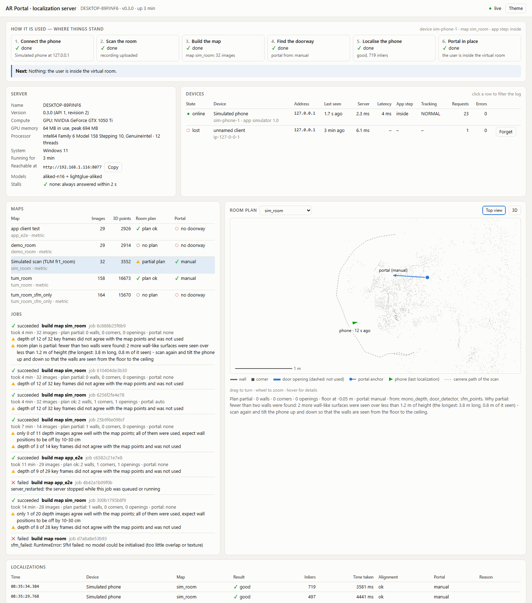

# locserver — self-hosted markerless visual localisation

A small server that recognises a previously scanned room from a single camera
image and tells an AR app where a virtual object (here: a doorway, the "portal")
has to be placed so that it appears at the same real-world position in every
app session — without markers, QR codes, GPS or manual placement, and without a
paid cloud service.

It is the self-hosted alternative to ViroReact's cloud VPS / Google Cloud
Anchors for the "Markerless AR-to-VR Portal" proof of concept. It is an
independent project: the mobile app talks to it over HTTP on the local Wi-Fi.

```
            ONCE (offline)                                EVERY APP SESSION (online)

 room video / images / AR recording            phone: camera image (+ its AR camera pose)
              │                                              │  HTTP POST /localize
              ▼                                              ▼
   ┌────────────────────┐                      ┌──────────────────────────────┐
   │  locserver-build-  │                      │  locserver-serve  (FastAPI)  │
   │  map (CLI)         │                      │                              │
   │                    │                      │  ALIKED keypoints            │
   │  frame selection   │                      │  VLAD retrieval: top-k map   │
   │  (subsample, blur) │                      │    images                    │
   │  ALIKED keypoints  │      map directory   │  LightGlue 2D-2D matches     │
   │  LightGlue matches │ ───────────────────► │    -> 2D-3D correspondences  │
   │  COLMAP SfM        │   features.npz       │  PnP + RANSAC (COLMAP)       │
   │  (+ metric scale   │   map.json           │    -> camera pose in the map │
   │   if AR poses)     │   anchors.json       │  + AR camera pose            │
   └────────────────────┘                      │    -> T_arworld_from_map     │
                                               │    -> anchor "portal" in AR  │
                                               │       world (pos + Euler)    │
                                               └──────────────────────────────┘
```

Contents: [Quick start](#quick-start-for-a-new-machine) · [Stack](#stack-and-licences) · [Setup](#setup-windows) ·
[Build a map](#build-a-map) · [Run the server](#run-the-server) · [Monitoring panel](#monitoring-panel) ·
[Without a phone](#without-a-phone-the-simulator) · [Connect a phone](#connect-a-phone) ·
[API](#api-reference) · [Conventions](#coordinate-conventions) ·
[App integration](#how-the-mobile-app-is-expected-to-call-it) ·
[Measured numbers](#measured-numbers) · [Limitations](#limitations-and-what-is-not-verified)

---

## Quick start for a new machine

For a Windows PC that has never seen this project (a colleague's laptop):

```powershell
# 1. tools: git and uv (https://docs.astral.sh/uv/) - nothing else
git clone <repository url> ; cd localization-server

# 2. environment (Python 3.13 and all packages; ~3 GB download, ~10 GB disk)
uv sync
uv run pytest                               # 172 tests, no GPU needed, about 5 minutes (4 of them need the phone captures and are skipped without them)

# 3. a map: either your own room video ...
uv run locserver-build-map data\input\room.mp4 --map-id room
#    ... or the public test sequence (782 MB download)
.\scripts\get_test_data.ps1
uv run locserver-build-map data\datasets\tum_fr1_room\rgbd_dataset_freiburg1_room --map-id tum_room --every 8

# 4. start the server; it prints the address to type into the app.
#    --panel also opens the monitoring panel in its own window
uv run locserver-serve --panel

# 5. no phone at hand? two simulated ones walk through the whole scenario: a staff
#    phone scans the room and places the door, a visitor phone gets room and door
#    (second PowerShell window; needs the test sequence of step 3; about 6 minutes)
uv run python scripts\simulate_phone.py

# 6. phone cannot connect? this read-only check says why and prints the fix
uv run locserver-doctor
```

**The two modes of the app (server 0.4.0).** A *staff member* scans a room
once, places the door and saves it on the server; a *visitor's* phone has
nothing but the app - it gets the room and the door from the server and only
has to look around. What the server offers for that: section 5, 7, 10 of
[`docs/api-v2.md`](docs/api-v2.md); what the simulator shows of it:
[Without a phone](#without-a-phone-the-simulator).

**One door, several ways to find the room (server 0.5.0).** The door is one
record in the room's frame. Whatever recognises the room - this server, or an
external service such as ReactVision Advanced VPS - only says where the room
is in the phone's AR world; the app puts the same door there. For a second
way the room stores its place at that service and a *bridge* (how the
service's map lies in the room's frame, with an error estimate), measured
once by the staff phone: section 5 and 11 of the API document.

**Which room? (server 0.6.0)** A visitor's phone does not have to say in which
room it is: `/localize` without a room id tries the rooms itself. The Wi-Fi
networks the phone sees only put the rooms in an order (the staff phone
leaves the networks seen in a room with it); where the phone stands is found
from the picture alone, and without any Wi-Fi the rooms are tried by how alike
the pictures are. Section 12 of the API document.

**State of verification (2026-11-21).** Everything runs end to end with the
simulated phones and with public test data. From a real phone the server has so
far only read two accidental one-second captures (enough to settle the file
format, see [Room plan](#room-plan-and-automatic-doorway-api-v2)); **a full
recording of a real room has not been processed yet**, so map quality, room plan
and doorway detection in a real room are unknown.

Nothing is tied to a particular PC, user, drive or Wi-Fi network: all paths
default to folders inside the project, and the address is whatever the PC has
on the network it is currently connected to. Then continue with
[Connect a phone](#connect-a-phone).

---

## Stack and licences

The pipeline is the "hierarchical localisation" recipe (retrieve similar map
images → match local features → PnP), built from these parts:

| Part | What | Licence | Source |
|---|---|---|---|
| ALIKED (`aliked-n16`) | learned keypoints + 128-d descriptors | BSD-3-Clause | <https://github.com/Shiaoming/ALIKED> |
| LightGlue (ALIKED weights) | learned feature matcher | Apache-2.0 | <https://github.com/cvg/LightGlue> |
| COLMAP via `pycolmap` 4.2 | SfM (mapping), PnP + RANSAC (localisation) | BSD-3-Clause | <https://github.com/colmap/colmap> |
| VLAD over ALIKED descriptors | global descriptor for retrieval (own code, codebook trained on the map) | — (this project) | `src/locserver/features.py` |
| PyTorch 2.14.1 + cu126 | inference | BSD-3-Clause | <https://pytorch.org> |
| FastAPI / Uvicorn | HTTP API | MIT / BSD-3-Clause | |
| OpenCV | image and video decoding | Apache-2.0 | |
| Depth Anything V2 **Small** | dense depth of key frames, for the room plan only | Apache-2.0 (the Base/Large variants are non-commercial and are not used) | <https://huggingface.co/depth-anything/Depth-Anything-V2-Small-hf> |
| Grounding DINO **tiny** | door boxes in key frames, for the room plan only | Apache-2.0 | <https://huggingface.co/IDEA-Research/grounding-dino-tiny> |
| Hugging Face `transformers` | runs the two models above | Apache-2.0 | <https://github.com/huggingface/transformers> |

No SuperGlue and no SuperPoint are used (both are non-commercial); every
component above is permissively licensed. This project itself: Apache-2.0.

**Why not `hloc` itself.** `hloc` (cvg/Hierarchical-Localization) was checked
first: its `main` branch does *resolve* for Python 3.13 on Windows together
with `pycolmap` 4.2.1 (`uv pip compile`, 2026-11-20), but it was not adopted:

* it is a batch toolbox built around HDF5 feature files and text pair lists; a
  server needs one in-memory query in ~1 s without touching the disk;
* its last changelog entry is from 2023 and `pycolmap` 4.x changed the database
  and pose APIs (rigs/frames), so each `hloc` code path would have had to be
  verified separately anyway;
* it pulls extra dependencies (h5py, gdown, plotly, kornia, third-party
  submodules such as NetVLAD weights from mirrors) that are not needed here.

So the same recipe is implemented directly on LightGlue + `pycolmap` (about
1,500 lines), which also keeps every step testable.

**Retrieval.** For a single room a heavy global-descriptor network is not
needed. The server aggregates the ALIKED descriptors of an image into a VLAD
vector (32 clusters × 128 d, codebook fitted on the map). No extra model, no
extra download, no extra licence.

### GPU support

The development PC has a GTX 1050 Ti (Pascal, 4 GB). Current PyTorch CUDA
builds (cu128 and newer) no longer contain kernels for Pascal cards. The last
official Windows wheels that do are the **CUDA 12.6** builds, and the last
PyTorch release shipping them is **2.14.1** (2.15 dropped cu126). The project
therefore pins `torch==2.14.1` from the `cu126` index; `torch.cuda.get_arch_list()`
reports `sm_61` and inference runs on the card. On a machine without a usable
GPU everything falls back to CPU automatically (`--device cpu` forces it).

---

## Setup (Windows)

Requirements: Windows 10/11, [uv](https://docs.astral.sh/uv/), git, about
10 GB of disk (4.5 GB environment + 4.9 GB uv cache, which `uv cache clean`
frees again). Python 3.13 is installed by uv if missing. No conda,
COLMAP binary, ffmpeg, Docker or compiler is needed.

```powershell
cd localization-server
uv sync            # creates .venv and installs everything (~3 GB download)
uv run pytest      # 172 tests, no GPU needed, about 5 minutes
```

By default everything stays inside the project folder or in the normal
per-user caches:

| What | Default location | Override |
|---|---|---|
| virtual environment | `.venv\` in the project | `UV_PROJECT_ENVIRONMENT` |
| uv package cache | uv's per-user cache | `UV_CACHE_DIR` |
| model weights (48 MB, downloaded on first use) | `%USERPROFILE%\.cache\torch` | `TORCH_HOME` |
| maps | `data\maps\` | `LOCSERVER_MAPS_DIR` or `--maps-dir` |
| per-device calibrations | `data\calibration\` | `LOCSERVER_CALIB_DIR` |
| public test data | `data\datasets\` | `LOCSERVER_DATASETS` |
| evaluation reports, upload scratch space | `data\work\` | `LOCSERVER_WORK` |
| listen address / port / server name | `0.0.0.0` / `8077` / host name | `LOCSERVER_HOST`, `LOCSERVER_PORT`, `LOCSERVER_NAME` or `--host`, `--port`, `--name` |

**Optional: large files on another drive.** If the system drive is small,
dot-source `env.ps1` in each new PowerShell window *before* `uv sync` / `uv run`:

```powershell
. .\env.ps1 -Root D:\locserver-data     # venv, caches, weights, test data and reports go there
```

To make that permanent for one machine, create an untracked `env.local.ps1`
next to it containing `$env:LOCSERVER_ROOT = "D:\locserver-data"`; then plain
`. .\env.ps1` is enough. Without a root, `env.ps1` changes nothing. (In the
examples below, test-data paths are written for the default layout.)

**GPU.** The project pins the CUDA 12.6 build of PyTorch 2.14.1 because it is
the last one that still supports GTX 10xx cards (see "GPU support"). It also
runs on newer NVIDIA cards up to the RTX 40 series. On a machine without an
NVIDIA GPU, or with one that this build does not support (e.g. RTX 50 series),
the server falls back to the CPU automatically: everything works, a query then
takes about 5 s instead of under 1 s. To use such a GPU, change the index in
`pyproject.toml` (`[[tool.uv.index]]` and `torch==...`) to a newer CUDA build.

---

## Build a map

A map is built once from a walk through the room.

```powershell
# your own room: put the video at data\input\room.mp4
uv run locserver-build-map data\input\room.mp4 --map-id room

# the public test sequence (fetch it with .\scripts\get_test_data.ps1)
uv run locserver-build-map data\datasets\tum_fr1_room\rgbd_dataset_freiburg1_room --map-id tum_room --every 8
```

Accepted inputs:

| Input | Scale of the map |
|---|---|
| video file (`.mp4`, `.mov`, …); the phone's rotation tag is honoured | arbitrary ("map units") |
| folder of images | arbitrary |
| ViroReact AR recording folder (`video.mp4` + `session.jsonl`) | **metric**, map frame = AR world of the mapping session (y up) |
| TUM RGB-D sequence folder (`rgb.txt` + `groundtruth.txt`) — test data | **metric** (motion-capture frame) |

What happens: frames are subsampled (`--fps 3` by default, at most
`--max-frames 200`), from every window only the sharpest frame is kept, frames
far below the median sharpness are rejected, images are scaled to
`--max-size 1024`; ALIKED features are extracted; each frame is matched with its
6 successors and its 8 most similar other frames (loop closure); COLMAP
verifies the matches and runs incremental SfM with a single shared camera whose
focal length and radial distortion are self-calibrated. In a sequential capture,
short runs of images that "jump" off the camera path (a step more than 8× the
median step away and back) are treated as wrongly registered and left out of
the map (`dropped_outlier_images` in `map.json`).

If the capture carries metric camera poses (AR recording, test data), they are
used twice: as position priors inside COLMAP's bundle adjustment (σ = 5 cm,
robust loss), which stops the model from drifting, and for a final RANSAC
similarity fit that makes the map metric. `map.json` reports how well the model
agrees with those poses (`metric_alignment`: inliers within 10 cm, RMS, max).
`--no-pose-priors` keeps only the final fit, `--no-poses` ignores the poses.

A plain video cannot tell how large the room is, so its map is **not metric**
(`"metric": false` in `GET /maps`). The scale is then obtained from the phone's
AR tracking at run time — see [alignment](#alignment-to-the-ar-session).

Tips for the mapping video (they matter more than any parameter):

* walk slowly (≈ 0.3 m/s) and move sideways — pure rotation on the spot gives
  no depth; 40–90 s is plenty for one room;
* cover the area around the future doorway from the positions and heights from
  which users will look at it; close the loop (end where you started);
* landscape or portrait both work, but use the orientation the app will use;
* lights on, no people walking through, avoid pointing at blank walls only.

The output is printed as JSON (registered images, 3D points, reprojection
error, timings) and stored in `data\maps\<map-id>\`:

```
map.json        metadata: metric flag, scale, camera, statistics, build options and timings
anchors.json    named poses in map coordinates (edited through the API)
features.npz    everything the server needs: keypoints, descriptors, 3D points, poses, VLAD index
sfm\            the COLMAP model (open it with the COLMAP GUI if you like)
points.ply      the sparse point cloud (MeshLab, CloudCompare)
images\         the mapping frames
```

Rebuilding a map (`--overwrite`) creates a new coordinate frame; existing
anchors are therefore moved aside to `anchors.stale.json` instead of being kept.

---

## Run the server

```powershell
uv run locserver-serve                 # all network interfaces, port 8077, all maps in data\maps
uv run locserver-serve --panel         # the same, and open the monitoring panel in its own window
uv run locserver-serve --port 9000 --name "Lab laptop" --device cpu --maps-dir D:\maps
```

After loading the models (≈ 5 s) it prints where it can be reached:

```
AR Portal localization server "MY-PC" - service arportal-localization-server, API v1
  Reachable on the local network at:
    http://192.168.1.50:8077
  In the app: type that address into the server field, or tap "Find automatically".
  Check from the phone's browser: http://192.168.1.50:8077/health   (no answer? run: uv run locserver-doctor)

  Monitoring panel on this PC: http://127.0.0.1:8077/ui   (own window: uv run locserver-panel)
```

One line is printed per network interface; with several (Ethernet, Wi-Fi,
virtual adapters) use the one in the same network as the phone. Interactive
API docs: <http://localhost:8077/docs>.

Quick check without a phone:

```powershell
curl.exe http://localhost:8077/health
curl.exe -F "image=@data\maps\tum_room\images\000404.jpg" -F "map_id=tum_room" http://localhost:8077/localize   # a mapping frame: must be "good"
uv run locserver-localize some_photo.jpg --map-id tum_room      # same thing without the server
```

---

## Monitoring panel

A page that shows, live, what the server and the phones are doing. It is served
by the server itself, so there is nothing to install or build: no Node, no
separate program, and nothing is loaded from the internet (it works on a PC
without internet access).

```powershell
uv run locserver-serve --panel                       # server + panel window in one command
uv run locserver-panel                               # panel window for a server that is already running
uv run locserver-panel --port 9000                   # ... on another port
uv run locserver-panel --url http://192.168.1.50:8077   # ... on another PC of the network
```

`locserver-panel` opens the page in an "app window" of Microsoft Edge or Google
Chrome (no tabs, no address bar); without either of them, or with `--tab`, it
opens a tab of the default browser. Or simply open `http://localhost:8077/ui`
in any browser. If the server does not answer, the command says so and how to
start it.



| Block | What it shows |
|---|---|
| **How it is used** (top strip) | the six steps of the scenario - connect the phone, scan the room, build the map, find the doorway, localise the phone, portal in place - each marked done / now / to do / needs attention, and one line "Next: ..." with what to do. Derived from what the server sees (requests, jobs, maps, localisations) and from the step the app reports. With several devices it follows the one selected in the device list |
| **Server** | name, version, GPU or CPU, GPU memory, processor, uptime, the addresses to type into the app (with a Copy button), the models, and whether the server ever stopped answering ("Stalls", see below) |
| **Devices** | every client that has contacted the server: name, address, last seen, the server's handling time, the round-trip time the app measured, the app's current step and tracking state, request and error counts. **online** while the last request is less than 10 s old, otherwise **lost** (with a Forget button). A client that does not send the device headers appears as "unnamed client" under its IP address. Click a row to filter the logs and the strip to that device |
| **Maps** and **Jobs** | the loaded maps (images, 3D points, room plan, where the portal comes from); the running build with its progress bar, step and time left; finished builds with their result, warnings and errors |
| **Room plan** | the selected map from above: walls with length, corners, door openings with their confidence, the portal anchor with an arrow into the room, the map's 3D points, the camera path of the scan, and where the phone was at the last successful localisation. `3D` tilts the view; drag to turn, wheel to zoom, hover for details. Without a room plan it shows the points and the camera path only |
| **Localizations** | the last 30 `/localize` requests: time, device, map, result (good / weak / failed), inliers, time taken, alignment state, portal source, reason of a failure |
| **Device log** | the events the app sends (`POST /devices/{id}/log`): app, connection, tracking, scan, upload, job, localisation, portal, errors. Filter by device and level; hover a line for its data. Every event is also appended to `work\device-logs\<device_id>.jsonl` |
| **Server requests** | every request with device, status and time; the periodic polls are hidden by default |

Everything refreshes once a second. The panel is read-only except for
"Forget"; it keeps the last 2,000 events per device and the last 200
localisations in memory - after a restart of the server it starts empty (the
log files stay). The light or dark theme follows the system and can be
switched with the button at the top right. The address can carry start-up
choices: `/ui#view=3d&theme=dark&map=<map id>&device=<device id>`.

More pictures: [during a build](docs/panel/panel-building.png) ·
[room plan in 3D](docs/panel/panel-plan-3d.png) (the map of the whole test
sequence) · [dark theme](docs/panel/panel-dark.png).

What the app has to send for the device list and the log is section 9 of
[`docs/api-v2.md`](docs/api-v2.md): four HTTP headers on every request and
small batches of log events.

**Stalls.** Twice during development the server stopped answering for 13-17 s
and then went on as if nothing had happened; the cause was not found. Since
0.3.0 a watchdog notices when the server is silent for more than 2 s, writes
what every thread was doing at that moment to `work\stalls.log` and counts the
stalls in the panel's Server block. Disk writes were also moved out of the
places where they could hold up other requests. During the runs for this
README: none - four runs of the simulator with three complete builds, about 40 minutes of server time, and the server always answered within 2 s..

**Verified:** by the tests (`tests/test_monitor.py`) and by watching the page
through complete runs of the simulated phone below. **Not verified:** a log
sent by the real app from a phone - how its events read in the panel is still
to be seen (the app's own PC-side client has sent batches; they were accepted).
A phone running an app version without the headers shows up as an "unnamed
client" with its requests only.

---

## Without a phone: the simulator

`scripts/simulate_phone.py` plays the phones - two of them, one per mode of the
app. It makes the same requests the app makes, in the same order, with files
of the same shape, so the server, the build, the room plan and the panel can
be watched end to end without a device:

```powershell
.\scripts\get_test_data.ps1                      # once: the public test sequence (782 MB)
uv run locserver-serve --panel                   # window 1
uv run python scripts\simulate_phone.py          # window 2: staff, then visitor - about 6 minutes
uv run python scripts\simulate_phone.py --role visitor                 # one more visit (1 minute)
uv run python scripts\simulate_phone.py --role visitor --device-id sim-visitor-2 --name "Second visitor"
uv run python scripts\simulate_phone.py --role staff --keep-map        # staff after an app restart: recognise the room, then place the door
uv run python scripts\simulate_phone.py --door suggested               # the staff accepts the doorway the server found (if it found one)
uv run python scripts\simulate_phone.py --vps-bridge                   # the staff also measures the bridge to a made-up second positioning service
uv run python scripts\simulate_phone.py --role visitor --find-room picture   # a visitor without Wi-Fi: the rooms are tried by how alike the pictures are
```

What happens, and what you see in the panel:

**Staff phone** (`sim-staff-1`, role *staff*)

1. **Connect** - `/health` with the device headers; the device appears as *online*.
2. **Scan** - 10 s of "recording" (log events and the app step `scanning`; there is no camera).
3. **Upload** - `POST /maps/sim_room/recording` with `video.mp4`, `session.jsonl`,
   the room's name and the id of the AR session that recorded.
4. **Build** - polls `/jobs/{id}` once a second; the job bar moves through its seven steps.
5. **Room plan** - reads `/maps/sim_room/room` and `/portal`; the plan is drawn
   (on this short clip often with one wall or none - see the table below), and
   a doorway the server found is logged as a suggestion.
6. **The door** - the staff member "stands" where the recording ended and puts
   the door 1.5 m ahead on the floor, 0.9 x 2.0 m: `PUT /maps/sim_room/anchors/portal`
   with the pose in the AR session and that session's id. **No `/localize` is
   needed**: it is the session that recorded the room.

**Visitor phone** (`sim-visitor-1`, role *visitor* - it never scanned)

7. **Rooms** - `GET /maps`; it takes the room only if a staff member has placed
   its door (`portal_confirmed`), otherwise it stops with "ask a staff member".
   **Its first request does not name the room**: the server finds it, trying
   first the room whose Wi-Fi networks match the (made-up) ones this phone
   sends. `--find-room picture` sends none, `--find-room off` names the room.
8. **Localise** - up to six clips of 2.5 s (video + `session.jsonl`, as the app
   records them) go to `/localize`, as a *new* AR session that is turned by 35°
   and moved by about 1.5 m against the scan. The list fills, the phone marker
   moves on the plan.
9. **Door** - when the alignment is accepted, the staff's door comes back in
   this phone's own AR coordinates, with its size; the step becomes
   `portal_placed`, then `inside` for 20 s, and back out.

At the end it prints how far the server's alignment is from the offset the
script applied, and how far the door ends up from where the staff put it. It
is also the reference client for the device log (section 9 of the API
document) - `class Phone` in the script is the whole of it.

**What is real and what is not.** The files have the shape of the files a phone
writes (checked against captures of a Xiaomi 14 Ultra): H.264 frames stored in
the sensor's orientation with a 90-degree rotation tag, intrinsics for those
stored pixels, one pose line per frame for the camera of the upright picture,
33 / 67 ms between frames, `gravity` zero in the first pose line. The pictures
are a 10 s stretch of the public TUM `fr1_room` sequence (640 x 480, not
1920 x 1080) with the motion-capture ground truth in the role of the ARCore
poses; the clips for `/localize` use frames of the same walk that are not in
the uploaded recording (`--clips-from 1230` takes them from the end of the
sequence instead, when the camera comes back to where it started). So the
requests and the computation are real, the "phone" is not: no ARCore drift, no
hand-held motion blur at 1080p, no change of light between scan and visit.

Result on the development PC (GTX 1050 Ti), 2026-11-21:

| | Result |
|---|---|
| Recording | 188 frames in 9.97 s, 2.6 MB; upload 0.1 s |
| Build, three builds of the same recording | 226 / 225 / 246 s; 32 key frames in the map each time; 31 of 32 cameras within 10 cm of their recorded positions (median 2 cm); one reconstruction attempt each |
| Room plan | **differs between the builds.** First build: 2 walls (3.1 and 3.9 m), 1 corner, a closed-door candidate with confidence 0.51 - just above the 0.5 limit, so the portal came from the server (`source: "auto"`); whether there is a door at that place of the room is not known. Second and third build: no wall - both walls are seen over only 0.8-1.1 m of their height, the plan asks for 1.2 m. The server reports exactly that, and the simulator placed the portal by hand, as the app does |
| Localisation right after the scan (6 clips of the same walk, frames not in the recording) | 6 of 6 good in every run, 628-855 inliers, 1.5-3.2 s per clip. Alignment against the offset the script applied: 0.39 / 0.69 / 0.77 deg and 5.8 / 6.7 / 7.0 cm at the camera |
| Localisation from the end of the sequence (`--keep-map --clips-from 1230`, 2 clips fit) | 2 of 2 good, 497 and 719 inliers, 3.6-4.5 s per clip; 0.88 deg and 5.6 cm |
| **Two modes** (server 0.4.0, one more build of the same recording, 243 s): the staff phone saves the door right after the build | saved without any `/localize` (`alignment_used: "recording_session"`), 0.90 x 2.00 m |
| ...the visitor phone, a second device that never scanned | got 5 rooms, 2 of them with a staff door; 6 of 6 clips good; the door appeared after the first clip with its size; alignment 0.89 deg and 6.0 cm at the camera; **the door stands 8.6 cm from where the staff put it** |
| ...the staff phone after an app restart (`--role staff --keep-map`, another AR session) | one clip recognised the room (2.0 s, 712 inliers), then the door was saved through that session's alignment (`alignment_used: "session_alignment"`); a visitor afterwards: 6 of 6 clips good, 0.90 deg, 6.1 cm, the door 8.7 cm from the stored place |
| **Second way to find the room** (server 0.5.0, `--role both --keep-map --vps-bridge`; the service is made up, its map lies 40 m away and is turned by 70 deg): the staff phone, in a later AR session, measures the bridge from 8 moments | saved; the server's estimate 2.8 cm and 0.20 deg; **really 11.4 cm off at the door** - the error of that session's own alignment (one clip) is in the bridge and not in the estimate; the answer carries a warning that says so |
| ...a visitor gets the same door record both ways | through this server: 8.7 cm from where the staff put it; through the made-up service and the bridge: 11.5 cm |
| ...the same, measured **in the AR session that recorded the room** (one more build, 200 s) | the server's estimate 2.1 cm and 0.20 deg; really 1.1 cm off at the door; a visitor's door through the made-up service: 1.2 cm from where the staff put it (through this server: 7.1 cm) |
| **Which room** (server 0.6.0; five rooms on the server, two with a staff door - `sim_room` and `tum_room` are scans of the same real room): the visitor's first clip names no room and carries made-up Wi-Fi networks | the networks put `sim_room` first (score 0.53; nothing known for `tum_room`); found at the first try, 713 inliers, 0.75 s for the search |
| ...a second visitor without Wi-Fi (`--find-room picture`) | the picture led to `tum_room` first (841 inliers) - the other scan of the same real room, a correct recognition and still not the room of the visit: what the hint is for |
| Server during these runs | no stall; no failed request |

---

## Connect a phone

The app finds the server either by an address you type or by "Find
automatically", which asks every address of the phone's own /24 network for
`GET /health` on port 8077 and accepts the one that answers with
`"service": "arportal-localization-server"`. For either to work:

1. **Same network.** PC and phone must be on the same Wi-Fi / LAN (the PC may
   be on cable if it is the same router). Mobile data on the phone does not
   reach the PC. Automatic search only covers the phone's own subnet; with a
   different subnet or a non-default port, type the address by hand
   (`http://<pc-ip>:<port>`).

2. **Test from the phone's browser** before blaming the app: open
   `http://<pc-ip>:8077/health` (the address from the server's banner). You
   must see a line of JSON starting with `{"status":"ok","service":"arportal-localization-server"`.
   If the page does not load, the problem is the network or the firewall, not
   the app.

3. **Windows Firewall.** Windows drops unsolicited inbound connections. The
   server never changes system settings itself; run this once in an
   *administrator* PowerShell (replace 8077 if you use another port):

   ```powershell
   New-NetFirewallRule -DisplayName "AR Portal localization server (TCP 8077)" -Direction Inbound -Protocol TCP -LocalPort 8077 -Action Allow -Profile Any -RemoteAddress LocalSubnet
   ```

   and to remove it again:

   ```powershell
   Remove-NetFirewallRule -DisplayName "AR Portal localization server (TCP 8077)"
   ```

   Why `-Profile Any`: Windows classifies every network as *Private* or
   *Public*, and new Wi-Fi networks (and many wired ones) are *Public* by
   default. A rule limited to `-Profile Private` silently does nothing on a
   network Windows considers Public — a common reason for "it worked at home
   but not here". `-Profile Any` works for both, while
   `-RemoteAddress LocalSubnet` still restricts access to devices on the same
   local network, so the port is not opened to the internet side. (Switching
   the network to Private in Windows settings is an alternative, not a
   requirement.)

   Two traps: if Windows once showed its "allow Python to communicate on these
   networks?" prompt and it was cancelled, it created a **block** rule for
   `python.exe`, and a block rule wins over every allow rule; conversely, if it
   was accepted, a broad allow rule for `python.exe` already exists and no port
   rule is needed. `locserver-doctor` reports both cases.

4. **Let the doctor look.** `uv run locserver-doctor` (about 10 s, changes
   nothing) lists the PC's LAN addresses, whether the server is listening and
   on which interface, the network profile of each active connection, whether
   an inbound firewall rule covers the port, and prints the exact command for
   whatever is missing:

   ```
   [info] LAN address: http://192.168.1.50:8077   (Wi-Fi)
   [ OK ] Server "MY-PC" is running on port 8077 (version 0.6.0, API v1, maps: room).
   [info] Network "CampusNet" on Wi-Fi: profile Public
   [FIX ] No firewall rule lets inbound TCP 8077 through on Public networks, ...
              New-NetFirewallRule -DisplayName "AR Portal localization server (TCP 8077)" ...
   ```

5. **Client isolation.** Guest, hotel, dormitory and many university networks
   (including eduroam-style ones) forbid devices from talking to each other
   ("AP / client isolation"). Then everything on the PC is correct, the phone's
   browser still cannot open `/health`, and no setting on the PC can fix it.
   Workaround: turn on the phone's **hotspot** and connect the PC to it — the
   two are then on a private network of their own (the server prints a new
   address; the hotspot only carries the local traffic, mobile data is not
   needed for the localisation itself). A small travel router works too.

6. **Trusted networks only.** The server has **no authentication and no
   encryption**: anyone on the same network can query it, read map metadata
   and change or delete anchors. Run it on a home network, a hotspot or a lab
   network you trust, stop it when you are done, and never forward the port to
   the internet.

7. **Android and plain HTTP.** Release builds of an Android app refuse
   `http://` connections unless cleartext traffic is allowed for the server's
   address (see "How the mobile app is expected to call it").

---

## Room plan and automatic doorway (API v2)

The app can upload a recording of the room; the server builds the map in the
background and works out a simple plan of the room from it: floor, ceiling,
walls (rectangles), corners and **door openings**. The portal is then placed
into the best opening automatically - nobody has to position it by hand. If no
doorway is found the answer says so (`source: "none"`); a position is never
made up. The full contract for the client is in
[`docs/api-v2.md`](docs/api-v2.md); this section is the server-side view.

```powershell
# what the app does (reference client): upload, follow the progress, print the plan
uv run python scripts\demo_room_upload.py <folder with video.mp4 + session.jsonl> --map-id room

# recompute the plan of an existing map by hand, with a top-down picture
uv run python scripts\room_plan.py room --plot plan.png

# fetch the two extra models before the first use (otherwise downloaded on first use: 752 MB)
uv run python scripts\get_models.py
```

**How it works** (`src/locserver/roomplan.py`, `roomstage.py`):

1. *Dense depth.* Up to 40 key frames of the map go through Depth Anything V2
   Small, which gives depth only up to an unknown scale and shift per image.
   Both are fitted to the map's own 3D points visible in that image, so the
   depth becomes metric and consistent with the map. Images whose depth does
   not reproduce those points well (fewer than 70 % within 8 %, or a median
   error above 4 %) are left out.
2. *Floor, ceiling, walls.* The recording's ARCore poses make the map metric
   and gravity-aligned, so the floor is simply the lowest strong horizontal
   level and walls are vertical planes. Walls are found by RANSAC on the points
   with a horizontal normal; a plane only seen *through* another wall (the
   corridor behind an open door) and a plane with a parallel one close behind
   it (a cupboard) are discarded. Corners are intersections of neighbouring
   walls.
3. *Open doorways - geometry.* Every depth ray that crosses a wall plane says
   either "the surface is here" or "I measured something well behind it". A
   floor-standing, door-sized block of the second kind is an opening; a window
   does not reach the floor and is ignored.
4. *Closed doors - image detector.* Grounding DINO looks for "door / doorway"
   in the key frames. Each box is projected onto the wall it looks at
   (perspective-correct), must stand on the floor and have a door's size, and
   must not float in front of the wall (an open door leaf does). Boxes are
   merged across frames; one frame alone never suffices.
5. *Confidence.* Both kinds of evidence are combined; the best opening is used
   automatically from confidence 0.5.

A room mesh from the phone (OBJ/PLY, optional upload) adds points to step 2.

The build runs in a separate process (`locserver.jobworker`), one at a time;
`/health`, the job polling and `/localize` stay responsive. The localisation
models and the room-plan models are never on the GPU in the same process.

### Measured (room plan)

*Synthetic rooms* (`tests/test_roomplan.py`, exact ground truth, depth rendered
by ray casting; with 1 % depth noise, a rotated room, a cupboard and a window):
the tests require corners within 6-12 cm, the floor within 3 cm, the doorway's
position within 8-12 cm and its width and height within 12 cm (these are the
asserted limits, not a statistic); a closed door is found only with detector
boxes; a room with a closed door and no detector reports no opening.

*Public sequence* (TUM `freiburg1_room`: a cluttered office filmed with a
hand-held Kinect - no door ground truth, walls mostly hidden behind desks and
shelves, so this is a hard case and only the walls can be checked). Reference:
the same code fed with the Kinect's measured depth instead of the depth network.

| | Result |
|---|---|
| Network depth vs. Kinect depth, per key frame | median error 3.5 %; 7 of 40 frames (one stretch of the walk where the map itself is weak) were 25-34 % off |
| ...after leaving out frames by the rule of step 1 (17 of 40 dropped) | every remaining frame within 1-6 % |
| Main wall (4.9 m), network depth vs. Kinect depth | 5.9 cm, 0.7 deg (20.6 cm, 4.0 deg before that rule) |
| Other walls | found with Kinect depth (4 walls), **not** with network depth: only 2 of them were seen in the frames that passed |
| Floor level (true value 0 in this dataset) | 7 cm (network depth), 5 cm (Kinect depth) |
| Door detector on the 40 key frames | at score 0.30 it also fires on monitors, windows with blinds and posters (0.33-0.40); wooden-framed glass panels reach 0.48-0.53; the one real open doorway in view scores 0.58 - hence the 0.42 threshold and the three-frames rule |
| Time for the room plan (GTX 1050 Ti, 40 key frames) | 65-190 s |
| End to end through the running server: a recording in the phone's file shape cut from the same sequence (10 s, 188 frames, 32 used), sent by `scripts\simulate_phone.py` | upload, 7 stages with percentages, map + plan after 225-246 s; numbers in [Without a phone](#without-a-phone-the-simulator) |
| Repeatability: that recording built three times (SfM is not deterministic) | the map is the same every time (31 of 32 cameras within 10 cm of the recording; floor level -0.07 / -0.04 / -0.05 m). The plan is not: 2 walls + 1 corner + a door candidate (0.51) once, no wall twice - the two walls are seen over 0.8-1.1 m of height, at the 1.2 m limit. On a short desk-level clip the plan is a coin toss; the job result and the panel now say why |
| (correction, 2026-11-21) | two rows that stood here before were measured with a test recording whose vertical axis was wrong (z-up poses declared as y-up - an error in the test data, not in the server) and were removed |
| Server responsiveness during a build | 514 polls of `/health` + `/jobs/{id}` during one build: worst 139 ms and 22 ms. In the very first build a single poll took 17 s; it was not reproduced and its cause was not found |

**What this says about a real room: nothing yet.** No full recording from a
phone exists so far (two accidental captures of one second settled the file
format, nothing more). Expect the result to depend mostly on how the room was filmed
(see below) and on how much bare wall is visible.

### Recording advice (what makes or breaks the plan)

* **Walk, do not only turn.** Turning on the spot gives no parallax; the map's
  3D points become unreliable, the depth fitted to them is wrong by tens of
  per cent and the walls move with it. An arc or loop of a few metres is enough.
* Show the floor-wall edges and the whole door (both jambs, the top, the floor
  in front of it) from at least two positions 1.5 m or more away.
* Tilt the phone up and down along every wall: a wall counts only when it is
  seen over at least 1.2 m of its height (lower things are taken for furniture).
* Record the door in the state it will have later: an open doorway is found by
  geometry, a closed door only by the detector.

---

## API reference

Endpoints for the room recording, jobs, room plan, **the door placed by the
staff** (section 5), renaming and deleting a room (section 10), and for the
device list and device log (`/devices`, section 9), are described in
[`docs/api-v2.md`](docs/api-v2.md); everything below is v1 and still valid.
Where both describe the door (`anchors/portal`), the API document is newer.

All responses are JSON. Errors use HTTP status codes with `{"detail": "..."}`
(404 unknown map/anchor, 413 upload too large, 422 bad input).

### `GET /health`

Identity and status. It never touches the models, answers within milliseconds
even while a localisation is running, and works before any map exists — it is
what the app's automatic search and its "connected" indicator call.

```json
{"status": "ok",
 "service": "arportal-localization-server",
 "api_version": 1,
 "api_revision": 5,
 "capabilities": ["recording_upload", "jobs", "room_plan", "auto_portal", "device_log", "monitor_ui", "staff_door", "door_size", "rooms_admin", "service_bridge", "wifi_hint"],
 "server_version": "0.6.0",
 "server_name": "MY-PC",
 "version": "0.6.0", "device": "cuda", "device_name": "NVIDIA GeForce GTX 1050 Ti",
 "vram_mb": {"allocated": 56, "peak": 527},
 "models": {"extractor": "aliked-n16", "matcher": "lightglue-aliked", "max_keypoints": 2048},
 "maps": ["tum_room"], "maps_dir": "C:\\...\\data\\maps", "sessions": 0, "uptime_s": 12.3,
 "jobs": {"running": 0, "queued": 0}}
```

| Field | Meaning |
|---|---|
| `service` | constant `"arportal-localization-server"`; a client must reject a host that answers anything else |
| `api_version` | integer, increased only when the API changes incompatibly |
| `api_revision`, `capabilities` | what was added since without breaking anything: check a capability name before using a v2 feature ([`docs/api-v2.md`](docs/api-v2.md)) |
| `server_version` | version of this package (`version` is the same value, kept for older clients) |
| `server_name` | the PC's host name, or `--name` / `LOCSERVER_NAME` — shown in the app's status indicator |
| `status` | `"ok"` whenever the server answers |
| `maps` | ids of the loaded maps (may be empty) |

### `GET /maps` · `GET /maps/{map_id}` · `POST /maps/reload`

`GET /maps` lists the loaded maps with `metric`, `scale_m_per_unit`,
`num_images`, `num_points3D` and anchor names. `GET /maps/{map_id}` returns the
full `map.json` plus the anchors. `POST /maps/reload` rescans the maps
directory (after building a map while the server is running).

### Anchors: `GET|PUT|DELETE /maps/{map_id}/anchors/{name}` · `GET /maps/{map_id}/anchors`

An anchor is a named rigid pose in map coordinates — the doorway's predefined
position lives here as anchor `portal`. Two ways to store one:

```powershell
# 1. directly in map coordinates (rotation optional: quaternion_xyzw or rotation_euler_deg)
curl.exe -X PUT http://localhost:8077/maps/room/anchors/portal -H "Content-Type: application/json" -d '{\"position\": [2.0, 0.0, -3.0], \"rotation_euler_deg\": [0, 90, 0], \"note\": \"doorway\"}'

# 2. authoring from the app: "the doorway is HERE in my current AR session"
#    (pose of the doorway in AR world + the alignment of that session)
curl.exe -X PUT http://localhost:8077/maps/room/anchors/portal -H "Content-Type: application/json" -d '{\"ar_pose\": {\"position\": [0.4, 0.0, -2.1], \"rotation\": [0, 35, 0]}, \"session_id\": \"author-1\"}'
```

In form 2 the alignment is taken from `session_id` (a session that already has
a complete alignment) or passed explicitly as `"T_arworld_from_map": [[4x4]]`.
The second form is how the portal position is "predefined" in practice: once,
at authoring time, somebody places the doorway by hand in AR and stores it;
every later session restores it automatically.

`GET` returns `{"map_id", "name", "frame": "map", "position": [x,y,z],
"quaternion_xyzw": [x,y,z,w], "note", "updated_utc"}`.

### `POST /localize` (multipart/form-data)

| Field | Type | Meaning |
|---|---|---|
| `image` | file | JPEG/PNG camera image. Exactly one of `image` / `video`. |
| `video` | file | short clip; the sharpest frame of each of `max_frames` (default 3) equal parts is localised |
| `session_jsonl` | file | ViroReact `session.jsonl` belonging to `video`: gives per-frame AR poses and intrinsics |
| `map_id` | text | may be omitted if exactly one map is loaded |
| `fx, fy, cx, cy` | numbers | optional intrinsics of the uploaded image in pixels; `width, height` if they refer to another resolution |
| `intrinsics_mode` | `auto` \| `map` | `map`: the image comes from the same camera and zoom as the mapping capture |
| `device_id` | text | enables the per-device focal-length cache (see below) |
| `image_rotation_cw` | 0/90/180/270 | rotate the upload clockwise by this to make it upright (intrinsics are rotated with it) |
| `ar_pose` | JSON text | AR camera pose of this frame: `{"position":[x,y,z], "forward":[..], "up":[..]}` or `{"position":[..], "rotation":[ex,ey,ez]}` — exactly what ViroReact's `onCameraTransformUpdate` delivers |
| `ar_position`, `ar_rotation`, `ar_forward`, `ar_up` | `"x,y,z"` | the same as separate fields |
| `session_id` | text | accumulate observations of one app session (see alignment) |
| `persist_scale` | bool | store a reliably estimated scale in the map |

```powershell
curl.exe -F "image=@frame.jpg" -F "map_id=room" -F "device_id=pixel7" -F "session_id=run42" `
  -F "ar_pose={\"position\":[0.5,1.5,-1.0],\"forward\":[-1,0,0],\"up\":[0,1,0]}" http://<pc-ip>:8077/localize
```

Response (shortened):

```json
{
  "success": true,
  "quality": "good",
  "reason": null,
  "map_id": "room", "map_metric": false, "map_scale_m_per_unit": null,
  "pose": {
    "T_map_from_cvcam": [[..4x4..]],   "T_cvcam_from_map": [[..4x4..]],
    "T_map_from_arcam": [[..4x4..]],
    "position": [x, y, z],             "quaternion_xyzw": [x, y, z, w],
    "quaternion_xyzw_arcam": [x, y, z, w]
  },
  "num_keypoints": 1432, "num_matches": 612, "num_inliers": 388, "inlier_ratio": 0.634,
  "reprojection_error_px": {"mean": 1.9, "median": 1.6},
  "intrinsics_used": {"fx": 742.1, "fy": 742.1, "cx": 512.0, "cy": 384.0, "width": 1024, "height": 768, "hfov_deg": 69.2},
  "intrinsics_source": "estimated",
  "working_size": [1024, 768],
  "retrieved": [{"image": "000412.jpg", "matches_3d": 231}, "..."],
  "thresholds": {"good": {"min_inliers": 60, "min_inliers_if_focal_estimated": 100, "min_inlier_ratio": 0.25},
                 "weak": {"min_inliers": 25, "min_inliers_if_focal_estimated": 40}, "ransac_max_error_px": 8.0},
  "timings_ms": {"extract": 150.2, "retrieve": 1.1, "match": 820.4, "pose": 9.8, "total": 985.0},
  "frames": [{"index": 0, "success": true, "quality": "good", "num_inliers": 388, "has_ar_pose": true, "T_cvcam_from_map": [[...]]}],
  "session": {"session_id": "run42", "num_observations": 3},
  "alignment": { "...": "see below" },
  "elapsed_ms": 1012.4
}
```

`pose` is the camera in the map: `T_map_from_cvcam` with OpenCV camera axes,
`T_map_from_arcam` the same camera with ViroReact/OpenGL axes; `position` is the
camera centre (identical for both); `quaternion_xyzw` belongs to
`T_map_from_cvcam`, `quaternion_xyzw_arcam` to `T_map_from_arcam`. Intrinsics
and reprojection errors refer to `working_size` (the image after rotation and
down-scaling to the map's `image_max_size`); the pose does not depend on it.

#### Quality verdict

| `quality` | Rule | Meaning for the client |
|---|---|---|
| `good` | inliers ≥ 60 (≥ 100 if the focal length was estimated) **and** inlier ratio ≥ 0.25 | use the pose |
| `weak` | inliers ≥ 25 (≥ 40 if the focal length was estimated) | plausible, do not rely on it alone; send more frames |
| `failed` | anything else (`success: false`, `pose: null`, `reason` says why) | not this room / view not mapped / too dark or blurred |

Inliers are 2D–3D correspondences within 8 px of the PnP solution at the
working resolution. A pose whose estimated horizontal field of view is outside
25°–130° is rejected. The thresholds are returned with every response and are
set in `LocalizeOptions` (`src/locserver/localize.py`).

#### Intrinsics

The server works without intrinsics. In order of preference it uses: the
intrinsics sent with the request → `intrinsics_mode=map` (the map's own
self-calibrated camera) → the cached calibration of `device_id` → estimating
the focal length inside PnP (principal point assumed at the image centre, no
distortion). `intrinsics_source` says which one was used.

Estimating the focal length from one image costs accuracy (see measured
numbers), mostly along the viewing direction. Therefore, when `device_id` is
sent, every `good` result with an estimated focal length adds one sample to a
per-device calibration; after 5 samples that agree within 3 % (robust spread)
it is locked and used as fixed intrinsics from then on (`GET /calibration`,
`DELETE /calibration/{device_id}`). Calibrations are per aspect ratio, because
a cropped video stream has a different field of view than a photo.

A ViroReact recording carries the real intrinsics in `session.jsonl`; when it
is uploaded with the clip they are used automatically.

### Alignment to the AR session

What the app needs is not the camera pose in the map but the transform from
the map to **its current AR world**, which is different in every session. When
an AR camera pose accompanies the image, the response contains:

```json
"alignment": {
  "status": "ok",
  "T_arworld_from_map": [[..4x4 similarity: upper-left 3x3 = scale * R ..]],
  "scale": 1.0,
  "scale_source": "map_metric",
  "scale_reliable": true,
  "rotation_quaternion_xyzw": [x, y, z, w], "translation": [x, y, z],
  "observations_total": 1, "observations_used": 1, "inlier_mask": [true],
  "position_rms_m": 0.0, "rotation_max_deg": 0.0, "baseline_m": 0.0, "scale_rel_std": null,
  "anchors": {
    "portal": {"position": [-2.5, 0.0, -1.0], "rotation_euler_deg": [0, 90, 0], "quaternion_xyzw": [0, 0.7071, 0, 0.7071]}
  },
  "ar_pose_pairing": "request", "from_weak_localization_only": false, "scale_persisted": false
}
```

`anchors.<name>.position` (metres) and `rotation_euler_deg` can be passed
straight to `<ViroNode position={...} rotation={...}>`; the node's content must
be authored in metres with scale 1.

`scale_source` / `status`:

| Situation | Result |
|---|---|
| metric map (`map_metric`) | one frame is enough: `status: "ok"` |
| non-metric map whose scale was calibrated before (`map_calibrated`) | one frame is enough |
| non-metric map, ≥ 2 frames of this session taken ≥ 0.15 m apart | scale estimated from the AR tracking (`estimated_from_session`), `status: "ok"` |
| non-metric map, one frame or no camera travel | `status: "scale_unknown"`: only the rotation is known, `T_arworld_from_map` is `null`, `anchors` is empty |

Multi-frame estimation (`src/locserver/geometry.py: align_observations`): each
observation pairs a localised frame with the AR pose of the same instant. The
rotation is the chordal mean of the per-frame rotations; scale and translation
are a least-squares fit of the camera centres given that rotation; outliers are
removed by RANSAC over all minimal sets (an observation is an inlier if its
camera centre fits within 0.10 m and its rotation within 5°). Plain Umeyama on
the camera centres alone is deliberately not used: users walk roughly straight,
and collinear points leave the rotation about the walking direction undefined.

`scale_reliable` is true when the camera travelled ≥ 0.5 m among ≥ 3 inlier
frames and the estimated relative scale uncertainty (`scale_rel_std`) is ≤ 5 %.
With `persist_scale=true` such a scale is written to the map
(`scale_source: "ar_session"`), after which single frames suffice. A scale can
also be set by hand: `PUT /maps/{map_id}/scale {"scale_m_per_unit": 0.37}`.

Two ways to supply several observations:

* **session id** — send `session_id` with every `/localize` call of one app
  run. The server keeps the observations (30 min idle timeout, last 60) and
  every response carries the alignment over all of them.
  `GET /sessions/{id}` returns the current alignment, `DELETE` forgets it.
  Start a new id whenever the AR session restarts (its world frame changes).
* **stateless** — `POST /align` with the observations collected by the client:

```json
{"map_id": "room", "persist_scale": false, "observations": [
   {"T_cvcam_from_map": [[..from pose.T_cvcam_from_map..]], "ar_pose": {"position": [..], "forward": [..], "up": [..]}, "weight": 388},
   {"T_cvcam_from_map": [[...]], "ar_pose": {"position": [..], "rotation": [..]}}
]}
```

A clip uploaded together with its `session.jsonl` already contains one AR pose
per frame, so a single request yields several observations.

---

## Coordinate conventions

**Notation.** `T_a_from_b` is a 4×4 matrix that maps homogeneous column vectors
from frame `b` to frame `a`: `X_a = T_a_from_b · X_b`. Its last column is the
origin of `b` expressed in `a`. Matrices are JSON arrays of 4 rows (row-major).
Quaternions are `[x, y, z, w]` (unit, Hamilton) and every JSON key holding one
ends in `_xyzw`.

| Frame | Axes | Units |
|---|---|---|
| `map` | the SfM model (COLMAP "world"); right-handed, orientation arbitrary unless built from an AR recording (then y up) | metres if `metric`, else arbitrary "map units" |
| `cvcam` | camera, COLMAP/OpenCV: **x right, y down, z forward** (into the scene) | as the map |
| `arcam` | camera, ViroReact/ARCore/OpenGL: **x right, y up, looking along −z** | metres |
| `arworld` | AR session world: right-handed, **y up** (gravity), origin and heading where tracking started | metres |
| `anchor` | object frame, ViroReact convention: x right, y up, +z out of the front face | metres |

The two camera conventions differ by a 180° turn about x:

```
X_arcam = diag(1, −1, −1) · X_cvcam
```

Pixel coordinates follow COLMAP: the centre of the top-left pixel is
(0.5, 0.5), `u = fx·x/z + cx`, `v = fy·y/z + cy` with (x, y, z) in `cvcam`.

**ViroReact rotations.** `rotation={[x, y, z]}` is in degrees and means

```
R = Rz(z) · Ry(y) · Rx(x)        (rotate about the fixed X axis first, then Y, then Z)
```

for column vectors in a right-handed frame. This was read from the renderer
source (`VROQuaternion::VROQuaternion(x, y, z)` in ReactVision/virocore builds
`q = qz ⊗ qy ⊗ qx`; `VROQuaternion::toEuler()`, which produces the `rotation`
of the camera callbacks, is its inverse with y limited to ±90°). The camera
callbacks report `position`, `rotation`, `forward = R·(0,0,−1)` and
`up = R·(0,1,0)` of the renderer camera. The server accepts either
`forward` + `up` (preferred: no Euler ambiguity, no gimbal lock) or `rotation`.

**The alignment formula.** With the PnP result `T_cvcam_from_map = [R_c | t_c]`
(map units), the AR camera pose `T_arworld_from_arcam = [R_a | p_a]` (metres)
and `s` metres per map unit:

```
X_arworld = s · R · X_map + t        R = R_a · diag(1,−1,−1) · R_c
                                     t = s · R_a · diag(1,−1,−1) · t_c + p_a
anchor in AR world:   position = s · R · p_anchor + t,    rotation = R · R_anchor
```

### Worked example

A metric map with y up; the portal anchor is at `[2, 0, −3]` in the map with
identity rotation (the doorway faces map +z).

1. The server localises a photo: the camera is at `[2, 1.5, 0]` in the map,
   upright, looking along map −z — i.e. straight at the doorway from 3 m,
   1.5 m above the floor. In COLMAP form:

   ```
   T_cvcam_from_map = [[1,  0,  0, −2.0],
                       [0, −1,  0,  1.5],
                       [0,  0, −1,  0.0],
                       [0,  0,  0,  1  ]]
   ```

2. In today's AR session ViroReact reports for the same instant
   `position = [0.5, 1.5, −1]`, `rotation = [0, 90, 0]` (so `forward = [−1, 0, 0]`,
   `up = [0, 1, 0]`): this session started with a different origin and heading.

3. `R = R_y(90°) · diag(1,−1,−1) · diag(1,−1,−1) = R_y(90°)` and
   `t = R_y(90°)·diag(1,−1,−1)·[−2, 1.5, 0] + [0.5, 1.5, −1] = [0.5, 0, 1]`:

   ```
   T_arworld_from_map = [[ 0, 0, 1, 0.5],
                         [ 0, 1, 0, 0  ],
                         [−1, 0, 0, 1  ],
                         [ 0, 0, 0, 1  ]]
   ```

4. Portal in the AR world: `R_y(90°)·[2, 0, −3] + [0.5, 0, 1] = [−2.5, 0, −1]`,
   rotation `[0, 90, 0]`. Check: the camera at `[0.5, 1.5, −1]` looks along −x;
   the portal is 3 m further along −x and 1.5 m lower — the same relation as in
   the map. The app renders
   `<ViroNode position={[-2.5, 0, -1]} rotation={[0, 90, 0]}>`.

This exact example is the test `test_localize_worked_example_from_readme`.

---

## How the mobile app is expected to call it

One-time authoring (per room):

1. Record the room, build the map on the PC (`locserver-build-map`), start the server.
2. In an authoring screen of the app: localise a few frames with a `session_id`
   until `alignment.status == "ok"`, let the author place the doorway in AR,
   then `PUT /maps/{map}/anchors/portal` with the doorway's AR pose and the
   `session_id`. (Or put map coordinates there by hand.)

Every normal session:

```
start AR session, wait until tracking is NORMAL
repeat every ~1–2 s while the user looks around / walks:
    frame    = current camera image (see note below)
    cam      = latest onCameraTransformUpdate value, captured at the same moment
    response = POST /localize  {image, map_id, device_id, session_id, ar_pose: cam}
    if response.alignment.status == "ok" and
       (response.quality == "good" or response.alignment.observations_used >= 3):
        p = response.alignment.anchors.portal
        show <ViroNode position={p.position} rotation={p.rotation_euler_deg}> … doorway … </ViroNode>
        stop (or keep refining every few seconds and update if the pose moves < 0.3 m)
on failure: keep trying; after ~10 s tell the user to look at a textured part of the room
```

Fetch example (React Native):

```js
const body = new FormData();
body.append('image', {uri: fileUri, name: 'frame.jpg', type: 'image/jpeg'});
body.append('map_id', 'room');
body.append('device_id', 'pixel7-arframe');
body.append('session_id', sessionId);            // new id for every AR session start
body.append('ar_pose', JSON.stringify({position: cam.position, forward: cam.forward, up: cam.up}));
const res = await fetch(`${serverUrl}/localize`, {method: 'POST', body});
const {success, quality, alignment} = await res.json();
```

Notes for the app side:

* **Pairing matters.** The AR pose must belong to the very same instant as the
  image. A 100 ms mismatch while walking at 1 m/s is a 10 cm error. Capture the
  pose immediately before/after grabbing the frame and ask the user to hold
  still for the shot, or use the recording (`video.mp4` + `session.jsonl`),
  where each frame has its own pose.
* **Frame source.** ViroReact has no public "grab camera frame" call. The
  expected source is a ~1 s `startRecording()`/`stopRecording()` clip uploaded
  as `video` + `session_jsonl`. A screenshot of the AR view
  (`takeScreenshot`) also works as `image` as long as no virtual content is
  drawn over it; its field of view differs from the raw camera image, which
  the focal-length estimation / `device_id` cache absorbs.
* **Image orientation.** The server expects an upright image (as the user sees
  the scene). If you send a raw sensor image (landscape while the phone is held
  in portrait) add `image_rotation_cw=90` (or 270, depending on the device).
* **Cleartext HTTP.** Android blocks `http://` by default in release builds:
  allow it for the server's address (`android:usesCleartextTraffic="true"` or a
  network security config) — LAN only, there is no authentication.
* **Drift.** ARCore's world drifts slowly; re-localising every 10–20 s and
  re-placing the doorway only when it moved noticeably keeps it locked.

---

## Evaluation

```powershell
# A: hold out part of a map and localise it against the rest (works for any map, also your own)
uv run locserver-evaluate --map-id room --perturb all

# B: frames never used for the map, compared with independent ground truth (TUM test data)
uv run locserver-evaluate --map-id tum_room --gt-capture data\datasets\tum_fr1_room\rgbd_dataset_freiburg1_room --device both
```

Protocol A removes every 5th block of 4 consecutive map images (20 %) from the
map in memory, together with all 3D points that are then seen by fewer than two
remaining images, localises the removed images and compares with their SfM
poses. It needs no ground truth, but it is optimistic: the remaining 3D points
were triangulated with the help of the held-out views, and the queries come
from the same walk and lighting.

Protocol B localises frames that never entered SfM at all and compares with
the capture's own metric poses (motion capture for TUM, ARCore for a ViroReact
recording). This is the honest number; it includes the error of the map itself.
A small constant rotation between the pose source's body frame and the camera's
optical frame is estimated on the map images and removed from the query ground
truth (its size is printed), so that it is not counted as localisation error.

`--perturb` degrades the query images before localisation: `dark`, `bright`,
`low_contrast`, `gamma_bright`, `warm_tint`, `blur`, `downscale`, `noise`,
`dark_noise` (definitions in `src/locserver/evaluate.py`). It is a first proxy
for the lighting test, not a replacement for re-visiting the real room in the
evening. `--intrinsics map|estimate|both` compares known against unknown
intrinsics. A JSON report with every query is written to `data\work\` (or `LOCSERVER_WORK`).

## Measured numbers

All numbers: development PC (Intel i7-8750H, 16 GB RAM, GTX 1050 Ti 4 GB,
Windows 11), 2026-11-20, test sequence TUM RGB-D `freiburg1_room` (1362 frames,
640×480, 49 s hand-held walk around an office, with motion blur and rolling
shutter; ground truth from a motion-capture system). Reproduce with
`scripts\run_reference_evaluation.ps1`; the JSON reports hold every query.

> **Timing caveat.** A game (World of Warcraft) was running on the same GPU
> during all measurements (`nvidia-smi` showed 38 % GPU utilisation and 2.7 GB
> of the 4 GB in use while our server was idle). GPU times below are therefore
> pessimistic and noisy; re-run the evaluation on an idle machine for clean
> numbers.

### Map building

`locserver-build-map <sequence> --map-id tum_room --every 8`: 171 windows,
7 rejected as blurred, 164 frames used, median ≈ 1,000 keypoints per frame,
2,032 image pairs matched (1,674 kept).

| | SfM only (`--no-pose-priors`) | with pose priors (default) |
|---|---|---|
| total build time | 920 s | 785 s |
| – frame selection / ALIKED extraction | 40 s / 41 s | 18 s / 16 s |
| – LightGlue matching (2,032 pairs) | 490 s | 349 s |
| – geometric verification / incremental SfM (CPU) | 9 s / 332 s | 26 s / 365 s |
| images registered by SfM | 164 / 164 | 164 / 164 |
| images kept in the map | 164 | 158 (5 "jumped", 1 with < 75 3D points) |
| 3D points / mean reprojection error | 15,670 / 1.30 px | 16,673 / 1.28 px |
| map cameras within 5 / 10 / 25 cm of ground truth | 120 / 124 / 131 of 164 | 119 / 131 / 158 of 158 |
| largest camera error vs. ground truth | 26 m | 0.22 m |
| map size on disk | 71 MB | 71 MB |

The first column was produced before the two outlier filters existed; with the
current code its five "jumped" images would be dropped as well. In the second
column the "< 75 3D points" rule was applied to the finished map by the same
criterion that `mapping.py` now applies during the build.

**The important finding is in the last rows.** Pure SfM registered every image
and reported a fine reprojection error, yet five images were placed 25 m away
and a stretch of ~35 images was displaced by 0.2–0.65 m (drift across a weakly
connected, blurred part of the walk). Nothing in the SfM statistics reveals
that; only the comparison with independent poses does. With the capture's
poses as priors the worst deviation drops to 0.22 m (10–22 cm in that same
stretch, ≤ 5 cm for 75 % of the cameras).

### Localisation accuracy — protocol B (60 unseen frames vs. motion capture)

Map `tum_room` (with priors). "map" = intrinsics known, "estimate" = focal
length estimated per image. A constant 1.41° rotation between the mocap body
frame and the camera was removed.

| device | intrinsics | n | success | good | t median | t p90 | t max | R median | R max | false good | time median | time p90 |
|---|---|---|---|---|---|---|---|---|---|---|---|---|
| GPU | map | 60 | 93 % | 93 % | 2.8 cm | 15.2 cm | 24.2 cm | 1.24° | 5.80° | 0 | 0.79 s | 1.37 s |
| GPU | estimate | 60 | 93 % | 93 % | 4.7 cm | 15.3 cm | 24.8 cm | 2.05° | 5.89° | 0 | 0.55 s | 0.86 s |
| CPU | map | 12 | 100 % | 100 % | 2.2 cm | 3.1 cm | 8.2 cm | 0.82° | 2.74° | 0 | 5.1 s | 7.6 s |
| CPU | estimate | 12 | 100 % | 100 % | 4.9 cm | 7.2 cm | 10.3 cm | 1.63° | 3.84° | 0 | 4.9 s | 7.5 s |

(The CPU rows use the first 12 queries only, to keep the run short; they are a
timing reference, not a separate accuracy result.)

Share of all 60 queries within a tolerance (GPU): 5 cm / 5°: 58 % (map), 50 %
(estimate); 10 cm / 10°: 68 %, 70 %; 25 cm / 10°: 93 %, 93 %. "False good" =
verdict `good` but more than 25 cm or 10° off.

Where the errors come from:

* The 4 failures (7 %) are the frames 494–540, exactly the part of the walk
  whose images were dropped from the map as mis-registered. The server answers
  `failed` there ("only N PnP inliers") instead of inventing a pose.
* All 12 results with more than 12 cm error lie in the stretch 555–836, where
  the *map* deviates from the ground truth by 10–22 cm. They have hundreds of
  inliers: the camera is localised correctly relative to a locally shifted map.
* Estimating the focal length costs about 2 cm / 0.8° in the median; the
  estimated focal lengths ranged from 508 to 575 px (true value 530 px, ±8 %).

Same protocol on the SfM-only map: 100 % "success", all `good`, median 2.9 cm —
but p90 64 cm, maximum 26.4 m and **18 confidently wrong answers** out of 60
(25 cm / 10° recall 70 %). The quality verdict measures agreement with the map,
it cannot detect a wrong map.

### Localisation precision — protocol A (30 held-out map images vs. SfM poses)

Every 5th block of 4 images removed from the map (128 mapping images left):

| device | intrinsics | n | success | good | t median | t p90 | t max | R median | R max | false good |
|---|---|---|---|---|---|---|---|---|---|---|
| GPU | map | 30 | 100 % | 97 % | 0.2 cm | 0.9 cm | 16.1 cm | 0.10° | 3.11° | 0 |
| GPU | estimate | 30 | 97 % | 97 % | 2.3 cm | 5.0 cm | 7.2 cm | 1.57° | 1.86° | 0 |

This is the repeatability of localisation relative to the map (optimistic, see
"Evaluation"); together with protocol B it says that the remaining error is
dominated by the map, not by the per-image localisation.

### Degraded query images — protocol B, GPU, known intrinsics, 60 queries

| perturbation | success | good | t median | t p90 | t max | R median | false good |
|---|---|---|---|---|---|---|---|
| none | 93 % | 93 % | 2.8 cm | 15.2 cm | 24.2 cm | 1.24° | 0 |
| dark (γ 2.0, ×0.6) | 93 % | 92 % | 2.9 cm | 15.2 cm | 24.1 cm | 1.22° | 0 |
| bright (×1.6 + 20, clipped) | 93 % | 93 % | 3.0 cm | 15.5 cm | 23.1 cm | 1.12° | 0 |
| low contrast (×0.4) | 92 % | 88 % | 2.6 cm | 15.4 cm | 23.1 cm | 1.22° | 0 |
| gamma bright (γ 0.5) | 93 % | 93 % | 2.9 cm | 15.4 cm | 24.2 cm | 1.16° | 0 |
| warm tint (lamp light) | 93 % | 93 % | 2.9 cm | 15.3 cm | 24.2 cm | 1.20° | 0 |
| blur (Gaussian σ 2.5 px) | 90 % | 83 % | 2.7 cm | 15.2 cm | 22.6 cm | 1.18° | 0 |
| downscale (½ resolution) | 93 % | 93 % | 2.8 cm | 15.7 cm | 23.7 cm | 1.24° | 0 |
| noise (σ 12) | 93 % | 93 % | 3.0 cm | 15.3 cm | 23.2 cm | 1.18° | 0 |
| dark + noise | 93 % | 92 % | 2.5 cm | 15.1 cm | 23.8 cm | 1.16° | 0 |

Global photometric changes hardly matter to ALIKED + LightGlue; blur is the
only one with a visible effect. This does not cover what really changes
between day and evening (shadows, reflections, lamps switched on, moved
objects) — that needs a second real capture.

### Time per query

| | GPU (shared with a game) | CPU |
|---|---|---|
| one 640×480 image, typical | 0.45–1.1 s (median of the runs above: 0.47–0.96 s, p90 0.85–1.4 s) | ≈ 5 s (p90 7.6 s) |
| example breakdown (0.45 s request) | ALIKED 70 ms, retrieval 6 ms, LightGlue 347 ms (3–8 pairs), PnP 24 ms | ALIKED ≈ 1.7 s, LightGlue ≈ 0.4 s per pair |
| 5-frame clip + `session.jsonl` (one request) | 3.5 s | — |
| model loading at server start | ≈ 5 s (first run downloads 48 MB of weights) | |
| peak VRAM | 0.5 GB at 640×480, 1.3 GB at 1024×768 | |

Matching dominates; it stops early once 600 2D–3D matches from at least three
map images are collected.

### Alignment end to end (through the running server)

`scripts\make_demo_recording.py` turned stretches of the test sequence into
ViroReact-format recordings whose poses were moved into a "new AR session"
(yaw 35°, shifted by 1.0 / 0.2 / −0.5 m); `scripts\demo_recording_query.py`
uploaded them like the app would and compared the returned `T_arworld_from_map`
with the known answer. `tum_room_units` is a copy of the map with scale and
orientation deliberately changed (true scale 2.7027 m per map unit).

| map | clip | frames used | scale | rotation error | placement error at the camera / 2 m ahead |
|---|---|---|---|---|---|
| `tum_room` (metric) | 4 s, camera baseline 0.40 m | 5 | 1 (map) | 1.1° | 3.2 cm / 4.3 cm |
| `tum_room_units` (no scale) | same | 6 | −6.5 %, flagged `scale_reliable: false` | 1.3° | 1.7 cm / 14.6 cm |
| `tum_room_units` | 10 s, baseline 2.1 m | 3 | +0.06 %, reliable | 1.0° | 3.2 cm / 2.7 cm |
| `tum_room_units` | same | 8 | +0.73 %, reliable | 1.1° | 3.8 cm / 1.9 cm |

The ≈ 1° rotation error is mostly the mocap-to-camera offset mentioned above.
The second row shows why the scale of a non-metric map needs camera travel:
0.4 m is not enough, and the server says so.

A single unseen 640×480 image without intrinsics over HTTP:
`success, good, 536 inliers of 562 matches, 463 ms`.

---

## Downloads

Everything was fetched from the official sources; nothing else is downloaded at
run time.

| What | Source | Size | Where |
|---|---|---|---|
| Python packages (PyPI): pycolmap 4.2.1, opencv-python 5.1.0, numpy, fastapi, uvicorn, python-multipart, kornia, …; dev: pytest, httpx, scipy, imageio-ffmpeg (bundles an ffmpeg binary, used by tests only) | <https://pypi.org> | together with torch: 4.5 GB installed, 4.9 GB cache | the virtual environment and uv's cache |
| torch 2.14.1+cu126, torchvision 0.29.1+cu126 | <https://download.pytorch.org/whl/cu126> | the bulk of the above | same |
| LightGlue (code, commit `5a650c4`) | <https://github.com/cvg/LightGlue> | < 1 MB | same |
| ALIKED weights `aliked-n16.pth` | <https://github.com/Shiaoming/ALIKED/raw/main/models/aliked-n16.pth> | 2.6 MB | `TORCH_HOME\hub\checkpoints` (default `%USERPROFILE%\.cache\torch`) |
| LightGlue weights `aliked_lightglue.pth` (v0.1_arxiv) | <https://github.com/cvg/LightGlue/releases/download/v0.1_arxiv/aliked_lightglue.pth> | 45.4 MB | same |
| `transformers` (PyPI) with `tokenizers`, `huggingface_hub`, `safetensors` | <https://pypi.org> | ~60 MB | the virtual environment |
| Depth Anything V2 Small weights (`model.safetensors` + config) | <https://huggingface.co/depth-anything/Depth-Anything-V2-Small-hf> | 95 MB | `HF_HOME` (default `%USERPROFILE%\.cache\huggingface`) |
| Grounding DINO tiny weights (`model.safetensors` + config, tokenizer) | <https://huggingface.co/IDEA-Research/grounding-dino-tiny> | 657 MB | same |
| Test data: TUM RGB-D `freiburg1_room` (CC BY 4.0), RGB + ground truth extracted, depth skipped (for the room-plan check extract it too: `tar -xzf fr1_room.tgz rgbd_dataset_freiburg1_room/depth rgbd_dataset_freiburg1_room/depth.txt`) | <https://cvg.cit.tum.de/rgbd/dataset/freiburg1/rgbd_dataset_freiburg1_room.tgz> | 782 MB archive, 0.56 GB extracted (`scripts\get_test_data.ps1`) | `data\datasets\tum_fr1_room` |

The test sequence is from: J. Sturm et al., "A Benchmark for the Evaluation of
RGB-D SLAM Systems", IROS 2012.

---

## Limitations and what is not verified

* **No full recording of a real room has been processed.** From a phone
  (Xiaomi 14 Ultra) the server has read two accidental captures of about one
  second (15 and 18 frames). They settled the file format - frames stored
  landscape with a 90-degree rotation tag, poses of the upright picture, one
  pose line per frame at a variable frame rate, quaternion order, mesh layout -
  and `tests/test_device_capture.py` checks the reader against them (the tests
  are skipped where those files are not present; they are not in the
  repository). They are far too short for a map, and the server now refuses
  such a recording at upload with the reason. Everything about map quality,
  room plan and doorway in a real room is therefore still unknown, as are: a
  recording of one to two minutes (size, upload time, build time), a phone held
  in landscape, an encoder that drops frames, and the uploaded mesh together
  with a recording.
* **A build can still produce a poor map.** Structure from motion is not
  deterministic; on a hard stretch of the test sequence one build put half of
  the cameras 0.3-3 m away from their recorded positions and localisation
  against it was wrong by 8 degrees and 26 cm. The builder now repeats the
  reconstruction when fewer than 60 % of the cameras agree with the recording,
  leaves out single images that are far off, and reports a poor or thin map as
  a warning (job result and panel). The limits of the rule are tested
  (`tests/test_mapping_warnings.py`); every build since then came out good, so
  the warning itself has not been seen again.
* **The room plan of a short scan is not repeatable.** Three builds of the same
  10 s test clip gave the same map and three times the same localisation, but
  two walls, a corner and a door candidate once and no wall twice: both walls
  are seen over only 0.8-1.1 m of their height, right at the 1.2 m the plan
  asks of a wall (the rule that keeps furniture out). The server now says so
  in the plan's `reason`, in the job warnings and in the panel, with what to do
  ("tilt the phone up and down so that the walls are seen from the floor to
  the ceiling"). Whether a real scan with a phone held upright - which sees
  far more of a wall's height than this 640 x 480 clip - has the same
  weakness is not known.
* **Whether `onCameraTransformUpdate` delivers degrees** was verified in source
  only for `getCameraOrientationAsync`; sending `forward` + `up` avoids the
  question.
* **A map built from a plain video can be silently wrong.** On the test
  sequence pure SfM produced a model with a fine reprojection error in which
  five images were 25 m off and a stretch of the walk was shifted by up to
  0.65 m; localisation against it returned confident but wrong poses (see
  "Measured numbers"). The jump filter removes the gross cases, but drift can
  only be prevented when the capture carries metric poses (AR recording),
  which is the unverified input kind. For a plain video: walk slowly, close the
  loop, and look at `points.ply` / the camera path before trusting the map.
* **Lighting, moved furniture, people** were only approximated by synthetic
  image perturbations. Real evening/daylight differences change shadows and
  reflections, which a brightness curve does not model.
* **Scale of a plain-video map** comes from ARCore at run time and inherits its
  error; a metric map from an AR recording avoids that but its reader is the
  unverified part above.
* **Accuracy needs parallax.** Far-away, low-texture or repetitive views
  (blank walls, ceilings, identical cabinet doors) give weak or failed results;
  the verdict thresholds are tuned on one public sequence only.
* **The room plan has never seen a real phone recording.** It is verified on
  synthetic rooms and, for the walls only, on one public sequence. Known weak
  points: walls hidden behind furniture are not found or are found at the
  furniture; white walls give the map few 3D points, which is exactly where the
  depth has to be extrapolated; glass doors, mirrors and floor-length windows
  confuse both depth and detector; the detector's idea of a "door" includes
  cupboard doors and wooden panels (the size and floor checks remove most, not
  all). A wrong doorway is possible - the app should let the user reject it
  (`PUT /maps/{id}/portal`, or the manual anchor).
* **Rooms are assumed to have a flat floor and vertical walls**; one room per
  map; no curved walls, no stairs, no sloped ceilings.
* **One room, one server.** Retrieval is a VLAD index held in memory; fine for
  a few hundred map images, not for a building. One localisation runs at a time
  (4 GB VRAM); requests queue.
* **The two modes were run with simulated phones only.** Staff door, visitor
  flow, the panel's role column: tests and `scripts/simulate_phone.py`. Not
  verified: the real app in either mode, whether ARCore keeps its world still
  between the end of the recording and the moment the staff saves the door
  (the door is saved in that world without a new look at the room), and a
  visit on another day.
* **The second way to find the room exists as data and arithmetic only.**
  Place at an external service, the bridge and its error estimate are tested
  against a made-up service frame with known truth. No answer of the real
  service (ReactVision Advanced VPS) has been seen, so its frame conventions
  are an assumption, and the estimate of a bridge's error is a lower bound
  (see the table above and section 11 of the API document).
* **The Wi-Fi hint has only seen made-up networks.** The ordering of rooms is
  tested and was run with the simulator; no real phone has sent a real list.
  On Android the list needs the location permission and location switched on
  (section 12 of the API document) - the app has to work without it, and the
  server does.
* **Staff and visitor are not told apart by the server.** `X-Device-Role` is a
  label for the panel. Any device in the network can place or remove a door
  and delete a room (deleted rooms go to `data\maps\.trash`, nothing is
  erased). A staff PIN checked by the server is described as planned in
  section 10 of the API document and is not built.
* **No authentication, no TLS.** Intended for a trusted local network only
  (see "Connect a phone"). That includes the monitoring panel: anyone in the
  network who knows the address can open `/ui` and read the device logs.
* **The panel has only seen a simulated phone** and the app's PC-side test
  client. Its layout and the usage strip were checked with
  `scripts/simulate_phone.py`. The strip's "portal in place" and "inside" steps
  rely on what the app reports - the server cannot see them itself.
* **The server stopped answering for 13-17 s twice** during development; the
  cause is not known. A watchdog now records such moments (see "Monitoring
  panel").
* Timings on the development PC were measured while another application was
  using the same GPU (see the note in "Measured numbers").
